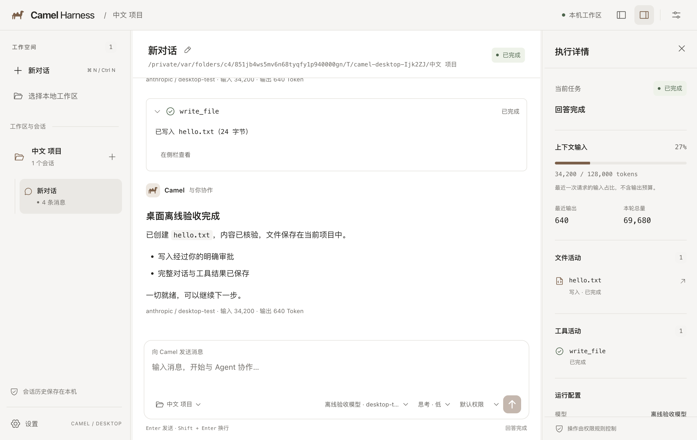
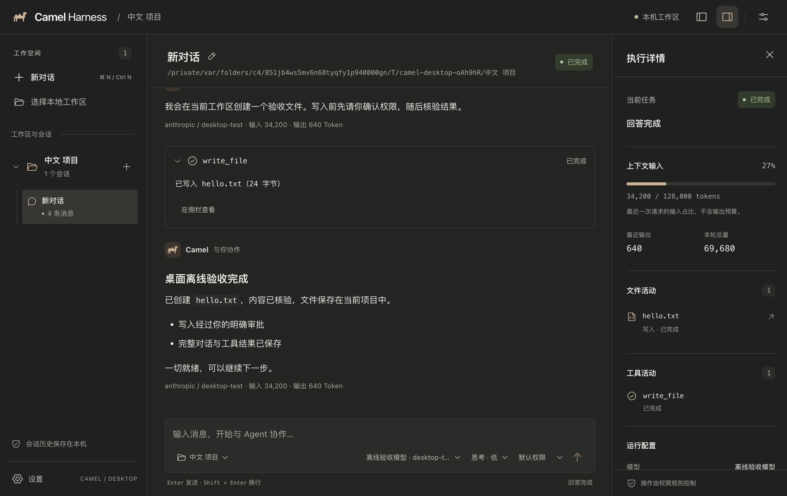

# Camel Harness

面向本地项目的桌面编程助手，可读取、修改代码并执行任务。底层是受 pi-agent 启发的轻量 Python Agent Runtime，Electron 负责窗口、React 界面与内置 Python 后端。

当前为 **1.1.0 桌面预览开发版**，源码位于 [`camel-harness-dev`](https://github.com/Camelovee/Camel-Harness/tree/camel-harness-dev)。GitHub 已发布的 1.0.1 不包含此桌面客户端；1.1.0 安装包尚未发布，可先按下文从源码运行。

打包目标为 macOS Apple Silicon、macOS Intel 和 Windows x64；本机已验证 Apple Silicon 应用，Intel Mac 和 Windows 的原生安装仍待验证。下载安装、源码开发及打包见 [桌面客户端说明](desktop/README.md)。

## 核心能力

- 流式 ReAct：规范生命周期事件，支持运行中追加输入、取消与恢复。
- 模型：使用官方 SDK 接入 Anthropic / OpenAI，默认 Anthropic。
- 工具：读、写、编辑、Shell；支持权限审批、MCP 与子 Agent 委派。
- 上下文：动态项目规则、有界长期记忆、Skill 三层按需加载、历史压缩与超限后的有界恢复。
- 会话：本地 JSONL 历史树，保存完整消息、模型和用量，子会话与大工具结果归属对应会话。

## 界面预览

简洁三栏工作台的浅色与深色界面，左右分隔线支持拖动调整宽度。截图来自临时项目和本机模拟服务，未使用真实密钥或外部模型。

- 左侧按工作区管理会话，点击工作区名称可展开或收起，保留当前对话、草稿和运行状态。
- 中间采用与聊天记录等宽的紧凑输入框，多行草稿自动增高；支持模型、思考强度和权限选择。
- 右侧展示真实执行状态、Token 用量、文件和工具活动，可进一步查看工具或子任务详情。
- 设置页固定头部与分类栏，内容独立滚动；主题支持浅色、深色和跟随系统，并响应“减少动态效果”偏好。





[设置界面预览](docs/images/desktop-settings.png) · [操作与快捷键](desktop/README.md#工作台操作)

## 从源码启动

需要 Python 3.11+、Node.js 24 和 [uv](https://docs.astral.sh/uv/)。

Windows 可在 PowerShell 中执行以下命令，无需安装 `fcntl` 或使用 WSL；`uv sync` 会安装 Windows 所需依赖。更新项目后请重新运行依赖安装。Windows 的 `run_shell` 使用 `cmd.exe` 语法，不是 PowerShell。

先获取项目，后续命令均在仓库根目录执行：

```bash
git clone --branch camel-harness-dev https://github.com/Camelovee/Camel-Harness.git
cd Camel-Harness
```

安装依赖并打开桌面客户端：

```bash
uv sync --locked --extra dev --extra desktop --python 3.11
npm ci --prefix desktop
npm run dev --prefix desktop
```

桌面工程会构建 React 界面并自动启动后端，只需一个终端。修改界面后关闭应用并重新执行启动命令。在首次模型设置中添加模型和密钥，保存后选择项目并开始任务；配置和选择目录不会触发模型调用。

后端只作为桌面内部服务运行，通过管道接收临时凭据、监听动态本机端口，不提供独立浏览器入口、固定端口服务或公开 API 文档。安装包用户无需安装开发工具，详见 [下载安装与打包](desktop/README.md)。

## 配置与数据

配置位于 `~/.camel/config.json`，缺失时自动创建，不读取环境变量或 `.env`。

Windows 对应 `%USERPROFILE%\.camel\config.json`；会话和用户记忆也位于该用户目录下。Unix 使用 `0700/0600` 权限，Windows 文件访问权限依赖用户目录继承的 ACL，不把 POSIX 权限位视为 Windows 隐私保证。

```json
{
  "models": [
    {
      "id": "main",
      "name": "主模型",
      "provider": "anthropic",
      "model": "claude-sonnet-4-6",
      "api_key": "填写你的密钥",
      "context_window_tokens": 128000,
      "max_output_tokens": 16384,
      "thinking_mode": "provider_default"
    }
  ],
  "default_model_id": "main"
}
```

OpenAI 模型使用 `provider: "openai"`；兼容端点可设置该模型的 `base_url`。`default_model_id` 指定默认模型，桌面界面可在会话间随时切换。完整字段见 [配置示例](config.example.json)。每个模型单独维护上下文窗口、单次输出预算和思考模式，需按服务商能力确认。输出预算包含服务商计入的思考 Token；`provider_default` 省略思考参数，不等于关闭思考。`anthropic_adaptive` 与 `openai_reasoning` 仅适用于对应 Provider 且支持这些参数的模型。

旧版全局输出预算和压缩窗口读取时迁入缺少字段的模型，已有显式值优先，保存只写新结构。`compaction` 仅维护压缩策略及摘要预算，窗口跟随当前模型；主请求与摘要额外保留 4096 Token 安全余量，压缩预留至少覆盖主输出预算与安全余量。Token 读数仍是 usage 优先、估算兜底的近似值。

工具参数截断后最多连续重新规划两次，正常响应清零；纯文本截断保留内容并提示未完成，不自动续写。

## 长期记忆

项目记忆存于 `<workspace>/.camel/memory/MEMORY.md`，用户档案存于 `~/.camel/memory/USER.md`；两者都是纯文本，条目以单独一行 `§` 分隔，分别受 2200 / 1375 字符上限约束。记忆在每个 Turn 完整注入系统提示，条目始终可见。

Agent 通过单个 `memory` 工具主动维护：`add` 追加条目，`replace` / `remove` 用唯一子串定位条目。写入不需要审批（PLAN 模式仍禁止），超过上限时先整合再添加。可要求 Agent“记住这个项目约定”或“保存为跨项目偏好”；用户档案影响所有工作区。

`config.json` 的 `memory` 默认值为 `{"enabled": true, "user_profile_enabled": true, "memory_char_limit": 2200, "user_char_limit": 1375}`。设 `enabled=false` 可关闭注入和工具，`user_profile_enabled=false` 只关闭用户档案；两者都不删除文件。修改配置后重启生效。

运行时不再读取旧 `*.json` 条目；升级后运行 `scripts/migrate_memory.py --workspace <工作区>` 预览，确认后加 `--apply` 迁移，旧文件保留。记忆不是会话摘要或项目规则，不自动提取、不保存秘密。自动允许写入意味着模型可能把外部内容持久化，残余风险见设计文档。Shell 不是沙箱，不能承诺阻止绕过。设计与验收见 [记忆系统设计](docs/方案设计/记忆系统设计.md)。

默认会话目录为 `~/.camel/sessions/<id>/`，子会话递归放在父目录的 `subagents/` 下，大工具结果放在所属会话的 `tool-results/` 下。相对 `session_dir` 按用户主目录解析，不是当前项目目录。

项目规则使用工作区 `AGENTS.md`；MCP 使用工作区 `.mcp.json`。Skill 来源优先级为内置 > 项目 `.camel/skills` > 用户 `~/.camel/skills`，发现只读名称与描述，正文和支持文件通过 `load_skill` 按需读取。

MCP 是可选集成；需要时将 [.mcp.example.json](.mcp.example.json) 复制为本机 `.mcp.json`，按本机安装目录修改 `command` 和 `args` 中的路径占位符。已有配置不要覆盖；`.mcp.json` 不纳入 Git，未配置时不影响核心工具。

复制项目到 Windows 后，若 `.mcp.json` 使用其他电脑的绝对路径，需按当前电脑修改 `command` 和 `args`；JSON 中 Windows 路径的反斜杠应写为 `\\`，也可使用正斜杠。

## 开发与验证

长期维护 `main` 与 `camel-harness-dev`：前者为稳定主线，后者统一集成桌面、Backend、Harness 和打包发布相关开发。较大功能可使用短期分支，完成后合回开发线；跨层需求在同一功能分支中联合验证。源码分层和资源所有权见 [项目架构](docs/项目架构.md)，回归覆盖与维护原则见 [测试说明](tests/README.md)。

```bash
uv run ruff check src tests scripts desktop/backend_entry.py
uv run ruff format --check src tests scripts desktop/backend_entry.py
uv run mypy src
uv run pytest -q
uv run lint-imports
npm test --prefix desktop
npm run build --prefix desktop
npm run test:smoke --prefix desktop
git diff --check
```

## 项目文档

- [项目架构](docs/项目架构.md)：当前桌面端、Backend 与 Harness 的职责、依赖和运行流程。
- [路书](docs/路书.md)：已实现能力、待验证事项及按需扩展范围。
- 方案设计：[桌面客户端](docs/方案设计/桌面客户端设计.md)、[上下文管理](docs/方案设计/上下文管理设计.md)、[工具安全](docs/方案设计/工具安全设计.md)、[会话](docs/方案设计/会话系统设计.md)、[上下文压缩](docs/方案设计/上下文压缩设计.md)、[记忆](docs/方案设计/记忆系统设计.md)。
- [会话性能基准](docs/会话性能基准.md)：本机全量重放测量方式及环境限制。

个人简历模板和面试准备位于本机 `docs/学习/`，整个目录已由 Git 忽略，不随仓库发布。

## 边界

- 面向单机本地使用，不是多租户服务；Shell 工作区限制不等于 OS 沙箱。
- 只保存完整消息，不保存 chunk；截断参数禁止执行，每 Run 最多一次模型恢复 Turn。
- 取消不保证撤销已完成的文件或命令副作用；恢复不自动重试历史工具。
- Provider 首事件前的上下文超限，每 Run 最多强制压缩并重发一次；压缩关闭、没有安全切点或仍超限时明确结束，不递归重试摘要请求。
- 上下文 token 为估算；会话格式不提供旧版本运行时兼容。不要提交密钥或个人会话。

[项目架构](docs/项目架构.md) · [路书](docs/路书.md) · [变更记录](CHANGELOG.md)

## 许可证

[MIT](LICENSE)
