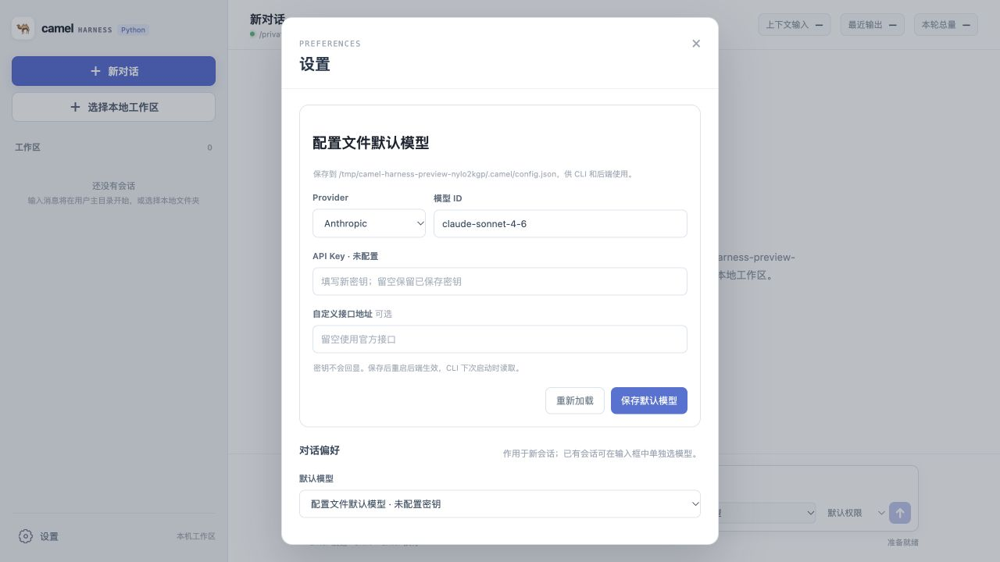

# Camel Harness

受 pi-agent 启发的轻量 Python Agent Runtime，用于在本地工作区读取、修改代码并执行任务。
提供 CLI 与 WebUI。

## 核心能力

- 流式 ReAct：规范生命周期事件，支持运行中追加输入、取消与恢复。
- 模型：使用官方 SDK 接入 Anthropic / OpenAI，默认 Anthropic。
- 工具：读、写、编辑、Shell；支持权限审批、MCP 与子 Agent 委派。
- 上下文：动态项目规则、Memory、Skill 三层按需加载、历史压缩与超限后的有界恢复。
- 会话：本地 JSONL 历史树，保存完整消息、模型和用量，子会话与大工具结果归属对应会话。

## 界面预览

实际 WebUI 默认模型设置截图，使用临时工作区与空白配置，未调用模型。



## 快速启动

需要 Python 3.11+、Node.js 24 和 [uv](https://docs.astral.sh/uv/)。

Windows 可在 PowerShell 中执行以下命令，无需安装 `fcntl` 或使用 WSL；`uv sync` 会安装 Windows 所需依赖。更新项目后请重新运行依赖安装。Windows 的 `run_shell` 使用 `cmd.exe` 语法，不是 PowerShell。

先获取项目，后续命令均在仓库根目录执行：

```bash
git clone https://github.com/Camelovee/Camel-Harness.git
cd Camel-Harness
```

### 后端启动

在第一个终端安装 Python 依赖并启动 FastAPI：

```bash
uv sync --locked --extra dev --python 3.11
uv run camel-harness-web
```

后端地址为 `http://127.0.0.1:8000`，API 文档为 `http://127.0.0.1:8000/docs`。后端可独立启动，无需先构建前端。

### 前端启动

在第二个终端进入仓库根目录，安装前端依赖并启动 Vite：

```bash
npm ci --prefix webui
npm run dev --prefix webui -- --host 127.0.0.1
```

访问 `http://127.0.0.1:5173`；前端通过 Vite 将 `/api` 请求代理到后端 `8000` 端口，需要保持两个终端运行。在“设置 → 模型”中添加模型并填写密钥，保存后立即生效，无需重启后端。

### 构建后由后端托管前端

不使用 Vite 开发服务时，先安装并构建前端，再启动后端；已运行的后端需重启才能加载构建产物：

```bash
npm ci --prefix webui
npm run build --prefix webui
uv run camel-harness-web
```

此时访问 `http://127.0.0.1:8000` 即可使用 WebUI，无需额外启动前端服务。

### CLI 启动

安装 Python 依赖后，也可直接使用 CLI，无需启动后端或前端；CLI 与 WebUI 使用同一份配置：

```bash
uv run camel-harness "分析当前项目" --workspace ./
uv run camel-harness  # 交互模式
```

交互模式支持 `/cancel` 和 `/resume`；`--session ID` 复用会话，`--latest-session` 选择当前工作区最近的会话。

## 配置与数据

配置位于 `~/.camel/config.json`，缺失时自动创建，不读取环境变量或 `.env`。

Windows 对应 `%USERPROFILE%\.camel\config.json`；会话和用户记忆也位于该用户目录下。Unix 使用 `0700/0600` 权限，Windows 文件访问权限依赖用户目录继承的 ACL，不把 POSIX 权限位视为 Windows 隐私保证。

```json
{
  "models": [
    {
      "id": "main",
      "name": "主模型",
      "provider": "anthropic",
      "model": "claude-sonnet-4-6",
      "api_key": "填写你的密钥"
    }
  ],
  "default_model_id": "main",
  "max_output_tokens": 4096
}
```

OpenAI 模型使用 `provider: "openai"`；兼容端点可设置该模型的 `base_url`。`default_model_id` 指定默认模型，WebUI 可在会话间随时切换。完整字段见 [配置示例](config.example.json)。`compaction` 单独配置压缩窗口、近期保留量及摘要输出预算；`max_output_tokens` 只限制单次输出，用量累计仅用于审计。

## 长期记忆

项目记忆存于工作区 `.camel/memory/`，用户记忆存于 `~/.camel/memory/`，同名项目优先。可要求 Agent“记住这个项目约定”或“保存为跨项目偏好”；模型通过 `save_memory` 提交实际内容，用户批准后才保存，YOLO 也不跳过审批。查询、分页读取和删除分别使用 `search_memory`、`read_memory`、`delete_memory`；修改需携带读取的版本，冲突后重新读取并审批。

`config.json` 的 `memory` 默认值为 `{"enabled": true, "max_entries": 5, "context_tokens": 2000}`。每 Turn 只注入预算内的相关记忆，放不下正文时提示按需读取；设 `enabled=false` 可关闭注入和工具，不删除文件。修改配置后重启生效。

记忆不是会话摘要或项目规则，不自动提取、不保存秘密。旧 `name/description/content/kind` 格式不兼容，原文件不会被自动迁移或覆盖；工作区即主目录时项目层级回落到用户层级（同一目录，同名覆盖语义不变）。Shell 不是沙箱，不能承诺阻止绕过。设计与验收见 [记忆系统设计](docs/方案设计/记忆系统设计.md)，离线对照运行 `uv run python -m evals.memory_protocol`。

默认会话目录为 `~/.camel/sessions/<id>/`，子会话递归放在父目录的 `subagents/` 下，大工具结果放在所属会话的 `tool-results/` 下。相对 `session_dir` 按用户主目录解析，不是当前项目目录。

项目规则使用工作区 `AGENTS.md`；MCP 使用工作区 `.mcp.json`。Skill 来源优先级为内置 > 项目 `.camel/skills` > 用户 `~/.camel/skills`，发现只读名称与描述，正文和支持文件通过 `load_skill` 按需读取。

MCP 是可选集成；需要时将 [.mcp.example.json](.mcp.example.json) 复制为本机 `.mcp.json`，按 [RepoAtlas 演示](docs/repoatlas-mcp-demo.md) 替换路径占位符。已有配置不要覆盖；`.mcp.json` 不纳入 Git，未配置时不影响核心工具。

复制项目到 Windows 后，若 `.mcp.json` 使用其他电脑的绝对路径，需按当前电脑修改 `command` 和 `args`；JSON 中 Windows 路径的反斜杠应写为 `\\`，也可使用正斜杠。

## 开发与验证

```bash
uv run ruff check src tests evals scripts
uv run ruff format --check src tests evals scripts
uv run mypy src
uv run pytest -q
uv run lint-imports
uv run python -m evals.run
npm run test --prefix webui -- --run
npm run build --prefix webui
git diff --check
```

离线评测使用固定模型事件，只验证协议；真实模型效果与失败样本见 [评测说明](evals/README.md)，不能将离线通过率当作真实任务成功率。

## 边界

- 面向单机本地使用，不是多租户服务；Shell 工作区限制不等于 OS 沙箱。
- 只保存完整消息，不保存 chunk；截断参数禁止执行，每 Run 最多一次模型恢复 Turn。
- 取消不保证撤销已完成的文件或命令副作用；恢复不自动重试历史工具。
- Provider 首事件前的上下文超限，每 Run 最多强制压缩并重发一次；压缩关闭、没有安全切点或仍超限时明确结束，不递归重试摘要请求。
- 上下文 token 为估算；会话格式不提供旧版本运行时兼容。不要提交密钥或个人会话。

[项目架构](docs/项目架构.md) · [路书](docs/路书.md) · [变更记录](CHANGELOG.md)

## 许可证

[MIT](LICENSE)
