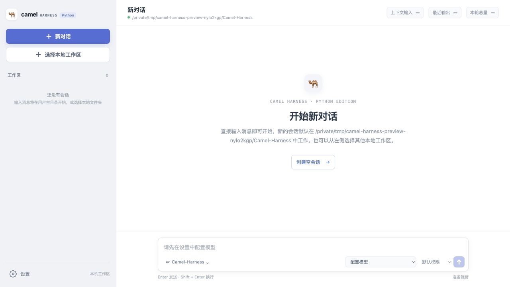

# Camel Harness

受 pi-agent 启发的轻量 Python Agent Runtime，用于在本地工作区读取、修改代码并执行任务。提供 CLI 与 WebUI，不依赖 DDD 或多层框架。

## 核心能力

- 流式 ReAct：规范生命周期事件，支持运行中追加输入、取消与恢复。
- 模型：使用官方 SDK 接入 Anthropic / OpenAI，默认 Anthropic。
- 工具：读、写、编辑、Shell；支持权限审批、MCP 与子 Agent 委派。
- 上下文：动态项目规则、Memory、Skill 三层按需加载与历史压缩。
- 会话：本地 JSONL 历史树，保存完整消息、模型和用量，子会话与大工具结果归属对应会话。

## 界面预览

实际 WebUI 截图，使用临时工作区与空白配置，未调用模型。



<details>
<summary>默认模型设置</summary>


</details>

## 快速启动

需要 Python 3.11+、Node.js 24 和 [uv](https://docs.astral.sh/uv/)。

```bash
git clone https://github.com/Camelovee/Camel-Harness.git
cd Camel-Harness
uv sync --locked --extra dev --python 3.11
npm ci --prefix webui
npm run build --prefix webui
uv run camel-harness-web
```

访问 `http://127.0.0.1:8000`，在“设置 → 配置文件默认模型”中填写模型和密钥，保存后重启后端。

CLI 使用同一份配置：

```bash
uv run camel-harness "分析当前项目" --workspace ./
uv run camel-harness  # 交互模式
```

交互模式支持 `/cancel` 和 `/resume`；`--session ID` 复用会话，`--latest-session` 选择当前工作区最近的会话。

## 配置与数据

配置位于 `~/.camel/config.json`，缺失时自动创建，不读取环境变量或 `.env`。

```json
{
  "provider": "anthropic",
  "model": "claude-sonnet-4-6",
  "anthropic_api_key": "填写你的密钥",
  "max_output_tokens": 4096
}
```

OpenAI 使用 `provider: "openai"` 和 `openai_api_key`；兼容端点可设置对应的 `*_base_url`。完整字段见 [配置示例](config.example.json)。`compaction` 单独配置压缩窗口、近期保留量及摘要输出预算；`max_output_tokens` 只限制单次输出，用量累计仅用于审计。

默认会话目录为 `~/.camel/sessions/<id>/`，子会话递归放在父目录的 `subagents/` 下，大工具结果放在所属会话的 `tool-results/` 下。相对 `session_dir` 按用户主目录解析，不是当前项目目录。

项目规则使用工作区 `AGENTS.md`；MCP 使用工作区 `.mcp.json`。Skill 来源优先级为内置 > 项目 `.camel/skills` > 用户 `~/.camel/skills`，发现只读名称与描述，正文和支持文件通过 `load_skill` 按需读取。

## 开发与验证

```bash
uv run ruff check src tests evals scripts
uv run ruff format --check src tests evals scripts
uv run mypy src
uv run pytest -q
uv run lint-imports
uv run python -m evals.run
npm run test --prefix webui -- --run
npm run build --prefix webui
git diff --check
```

离线评测使用固定模型事件，只验证协议；真实模型效果与失败样本见 [评测说明](evals/README.md)，不能将离线通过率当作真实任务成功率。

## 边界

- 面向单机本地使用，不是多租户服务；Shell 工作区限制不等于 OS 沙箱。
- 只保存完整消息，不保存 chunk；截断参数禁止执行，每 Run 最多一次模型恢复 Turn。
- 取消不保证撤销已完成的文件或命令副作用；恢复不自动重试历史工具。
- 上下文 token 为估算；会话格式不提供旧版本运行时兼容。不要提交密钥或个人会话。

[项目架构](docs/项目架构.md) · [路书](docs/路书.md) · [开发日志](docs/开发日志.md) · [变更记录](CHANGELOG.md)

## 许可证

[MIT](LICENSE)
