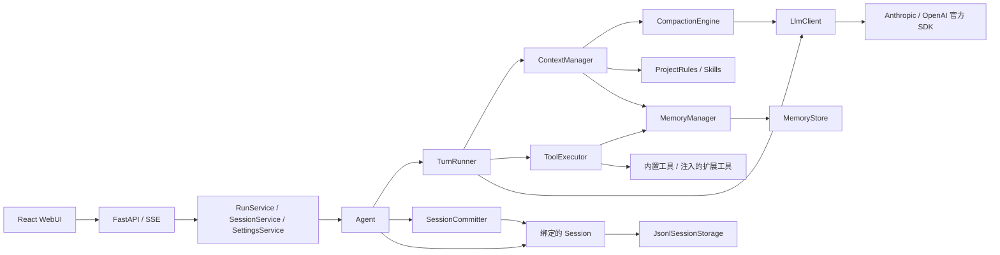

# 项目架构

Camel Harness 是面向本地代码任务的 Python Agent Runtime，通过 FastAPI 后端和 React WebUI 提供交互。当前交付使用 Web 入口 `camel-harness-web`；Python 代码由 `camel_backend`、`camel_harness` 两个根包组成。会话和配置保存在本机文件中，没有数据库、独立任务队列或跨进程 Run 调度器。

## 1. 目录与依赖

```text
src/
├── camel_backend/
│   ├── main.py             # Web 应用生命周期、扩展注入、启动入口
│   ├── api/                # HTTP 契约、路由、错误映射、SSE
│   ├── orchestration/      # Run、会话、模型配置用例
│   ├── approval.py         # 浏览器审批队列
│   ├── settings_store.py   # 本机模型配置读写与脱敏投影
│   └── workspace.py        # 本机目录选择
└── camel_harness/
    ├── llm/                # 规范消息与流事件、Client、官方 SDK 适配
    └── agent/
        ├── agent.py        # Run/Turn 编排、取消、steering、恢复
        ├── events.py       # 运行事件与有界订阅交付
        ├── state.py        # 状态、停止原因、运行选项和已知用量
        ├── runtime.py      # 核心对象组合、扩展资源关闭
        ├── config.py       # 用户级 JSON 配置与模型解析
        ├── context/        # 上下文组装、压缩判断与提交协调
        ├── session/        # JSONL、历史树、快照、元数据与恢复分析
        ├── memory/         # 记忆类型、文件存储与对外记忆服务
        ├── tools/          # 工具契约、执行、授权、文件/Shell 与结果归档
        ├── resources/      # AGENTS.md 与 Skills
        ├── subagent/       # 委派工具和隔离子会话运行器
        └── platform_io.py  # 文件类型、链接和目录同步的平台适配
webui/src/
├── app/                    # 页面组合、全局布局和样式
├── features/               # agent、workspaces、settings
└── shared/                 # API 基础、协议类型和展示组件
tests/                      # 单元、协议、集成与验收回归
scripts/                    # 会话迁移与本机性能测量
```

Python 依赖方向为 `Backend → Agent → LLM`。LLM 不导入 Agent 或 Backend；Session 不导入运行事件或 Agent 对象，其 `types` 是包内叶子；Context 按次借用公开 Session 接口协调准备，不直接依赖会话存储实现，也不依赖 Run 状态。Memory 内部为 `MemoryManager → MemoryStore → types`，Context 和入口层只依赖 `MemoryManager`。Import Linter 集中检查这些规则，以及 runtime 不直接导入具体的可选工具 Provider。

前端依赖方向为 `app → features → shared`，feature 之间通过 app 组合。Python 与前端通过 HTTP/SSE 契约交互，不共享 SDK 对象。



## 2. 组件职责

| 组件 | 负责 | 边界 |
| --- | --- | --- |
| Backend | 校验请求、解析模型、定位会话、维护 Agent 与审批、编码 SSE | 不复制 ReAct 循环 |
| Agent | 公开生命周期、Run 登记与取消、steering、唯一终态和资源关闭 | 不直接消费模型流、不保存消息 |
| TurnRunner | 单 Turn 的上下文准备、请求构造、流消费、溢出重试、工具分发和 Turn 事件 | 不决定 Run 终态，不处理 steering、Run 超时或清理 |
| SessionCommitter | 先保存完整消息再发送确认，保存失败标记 `SESSION_FAILED` | 不生成内容，不决定模型或工具行为 |
| LLM | 厂商无关消息/事件、响应完整性检查、Provider 路由和官方 SDK 调用 | 不感知 Session、Run、审批或文件存储 |
| ContextManager | 按次借用 Session 读取快照，组装提示、判断是否需要压缩并协调提交，返回完整提示和消息 | 不持有会话绑定、不直接操作存储或文件锁，不感知运行状态 |
| CompactionEngine | 选择安全切点、生成并校验摘要，返回不可变压缩计划 | 不判断触发条件、不修改 Session |
| Session / SessionManager | 前者绑定单会话并提供运行所需能力；后者管理创建、元数据和父子关系 | 原始历史与模型上下文分别投影 |
| MemoryManager / MemoryStore | 前者判断开关、校验内容与上限并渲染提示；后者维护两个记忆文件的路径、锁与原子提交 | 存储层不接收设置，不感知 Agent 运行状态或工具协议 |
| Tools | 注册、参数校验、授权、超时、执行和结果归一化 | 不驱动下一轮模型推理 |

Agent 通过 ToolExecutor 查询模型可见工具定义并执行调用，不单独接收 ToolRegistry。注册表由组装层创建和注册，ToolExecutor 始终从该表实时查询，保证定义和执行使用同一来源。执行前固定工作目录和参数快照，工具提供只读审批上下文；Shell 展示实际目录与完整命令。文件工具按路径串行化修改；写入接口仅保留 path/content、允许完整覆盖，批量编辑基于原始快照验证所有片段后一次原子提交。读取按行数和 16 KiB 字节上限分页，返回续读位置。完整覆盖不检测旧版本冲突；执行结果通过 metadata/details 区分未执行、成功、失败与结果未知。未知结果要求先核验，不触发自动重放。子 Agent 组装层仍使用注册表生成白名单工具集。

## 3. 一次 Web 请求怎样运行

1. 浏览器发送 `POST /api/sessions/{id}/runs`。`RunService` 在启动锁内检查会话，惰性创建或复用 Agent，并解析本次 `LlmModel`。不同会话可以同时运行，同一 Agent 只允许一个活动 Run。
2. Backend 先订阅事件，再启动 `agent.run()`；取得首事件后交付 SSE。Agent 自己持有执行任务，等待 `run()` 的调用方取消不会自动接管该任务。
3. Agent 保存新用户消息，将本次 Session 和模型交给 ContextManager；后者读取快照、组合基础提示与动态资源，判断是否需要历史压缩并生成计划。
4. 有压缩计划时，由 ContextManager 调用 Session 校验并提交，成功后返回提示和消息。Agent 的薄封装仅接入用量回调和会话／资源／上下文故障分类，再构造 `LlmRequest`。
5. Provider 增量实时投影到 `message_update.assistant_event`。完整响应组装成功后才保存 assistant 消息，然后串行执行该响应中的工具调用并保存完整结果。
6. Turn 安全点消费一条 steering 输入，或开始下一轮推理；结束时交付唯一 `agent_end` 并清理活动状态。

HTTP 的 Run/Resume 默认预算为 20 Turn；直接调用 Agent 的默认值为 50，子 Agent 为 8。运行时长和输出预算来自配置。累计 Token 是审计量，不是整次 Run 的停止额度。

Context 内的 `token_counting.py` 统一提供内容估算及 usage 优先的上下文读数。Session 仅在快照中投影压缩后的 usage 有效边界，不承担计数策略，也不新增持久化字段。

上下文超限和输出截断的恢复状态由 AgentRun 持有：超限每 Run 最多强制恢复一次；工具参数截断最多连续重新规划两次，正常响应清零，任何截断调用均返回未执行。纯文本截断保留内容，以 MODEL_LENGTH 结束，不自动续写。终态错误包含实际请求预算、输出／思考用量及恢复次数，未知用量明确显示未知；WebUI 区分输出截断、Turn 耗尽与上下文失败。新任务和 resume 创建独立运行状态。

## 4. 模型、事件与资源所有权

`LlmModel` 随每次 `run()`/`resume()` 进入，包含 Provider、模型、连接凭据、上下文窗口、输出预算与显式思考模式；适配器不长期持有这些状态。Backend 模型设置变更在下一次 Run 解析，同一 Agent 无需因模型切换重建。思考强度也属于本次 Run，API 值为 `low/high/max`，WebUI 标签分别显示低/中/高。

| 资源 | 所有者与关闭方式 |
| --- | --- |
| Agent Run | Agent 持有任务，显式 `abort()` 取消；`close()` 等待运行和扩展清理结束 |
| SDK Client / Stream | 适配器每次流式调用内创建，在 `finally` 关闭；`LlmClient` 关闭流生成器 |
| MCP 连接 | McpManager 的唯一连接任务进入、退出 SDK 上下文；关闭等待者取消不取消清理 |
| 可选扩展 | Backend 创建 Skill、MemoryManager、MCP 和委派工具，经 `AgentExtensions` 注入；runtime 组合并调用注册的关闭回调 |
| 子 Agent | 独立会话、活动任务和 ContextManager，借用共享 LLM、压缩引擎及动态资源；父任务取消时显式关闭子 Agent |

事件按订阅顺序交付，慢订阅者会产生背压，故障或超时订阅者会移除。SSE 使用容量为 256 的队列连接观察与输出；流断开时请求 `abort()`。它不是可重放的事件总线。`message_end` 表示完整消息已经保存；`tool_execution_start` 包含审批或拒绝过程，不能据此认定工具已实际执行。

模型配置与编辑接口共享能力字段，设置页按服务商确认窗口、输出上限和思考模式。provider_default 省略思考参数；另外两种显式模式仅允许对应 Provider。旧全局输出预算和压缩窗口在配置读取边界迁入各模型，保存不再输出旧字段。Context 统一处理窗口与输出安全余量，Agent 消费准备后的系统提示与历史，并直接使用模型配置的完整输出预算，超限恢复后保持相同额度；摘要使用同一模型，独立计算其首次／重试额度与剩余窗口限制。

主 Agent 由 `build_agent()` 组装；子 Agent 由 `build_subagent()` 创建隔离会话、角色上下文和白名单工具集。运行时绑定共享依赖后，将创建回调注入 `LocalSubagentRunner`；Runner 只负责执行、事件观察、取消清理和终态保存，并在运行入口对只读角色强制使用 PLAN 权限。子 Agent 借用共享资源，不注册其关闭回调；成功创建后由 Runner 负责关闭。请求、结果和回调类型集中在 `subagent/types.py`，创建与执行模块不相互依赖。

子任务通过工具调用上下文中的可选观察回调返回规范化子事件，TurnRunner 以 `subagent_event` 包装进父 SSE。外层使用父 Run 的坐标与序号，内层保留子 Run 身份；子终态只结束侧栏中的子任务，不结束父连接，也不把子过程写入父模型历史。Backend 观察父事件维护当前子任务视图，审批查询按真实会话元数据补充父子关联；前端独立投影父子消息，父会话摘要连接子任务详情侧栏。

子任务完整消息仍保存在各自 JSONL；收尾时通过 `session_info.taskOutcome` 记录终态、停止原因、错误和结束时间，不保存运行中状态或未完成增量。Runner 显式关闭子 Agent 后保存终态，保存故障作为结果存储故障传播。历史接口按父会话当前分支的委派调用过滤子任务；旧会话缺失终态时显示“历史状态未记录”。

## 5. 配置、数据与当前界面

- 全局配置：`~/.camel/config.json`，不读取模型环境变量或项目 `.env`。模型资料保存在 `models`，默认项由 `default_model_id` 选择；HTTP 设置快照只返回密钥是否已配置，不返回密钥。
- 会话：默认 `~/.camel/sessions/<id>/session.jsonl`；子会话位于父目录的 `subagents/<id>/`，大工具输出位于所属会话的 `tool-results/`。
- 资源：工作区根 `AGENTS.md`、内置/项目/用户 Skills、工作区 `MEMORY.md` 与用户 `USER.md` 两个有界记忆文件。MCP 使用工作区 `.mcp.json`，Server 的 `cwd` 固定为该工作区。
- WebUI：工作区和会话侧栏、逐 Turn 消息投影、工具与审批卡片、子任务完整过程侧栏、模型/思考强度/权限选择（default、plan、yolo）、运行中输入、取消与恢复。模型设置已实现，Skills/MCP 设置面板仍是预留入口。
- 项目私有学习材料放在 `docs/学习/`，该目录整体由 Git 忽略，不属于公开交付文档。

会话编解码只保存模型标识和用量等审计字段，不保存连接凭据对象。配置文件在 Unix 使用私有权限；Windows 依赖用户目录 ACL。Shell 和 MCP 都不是 OS 沙箱，不能将工作目录限制等同于不可信代码隔离。

## 6. 机制说明与验证入口

| 主题 | 文档 | 关键实现 |
| --- | --- | --- |
| 动态提示与资源选择 | [上下文管理设计](方案设计/上下文管理设计.md) | `agent/context/manager.py`、`agent/resources/` |
| 授权、文件边界与副作用 | [工具安全设计](方案设计/工具安全设计.md) | `agent/tools/`、`camel_backend/approval.py` |
| 历史树、提交与恢复 | [会话系统设计](方案设计/会话系统设计.md) | `agent/session/` |
| 历史压缩与超限恢复 | [上下文压缩设计](方案设计/上下文压缩设计.md) | `agent/context/manager.py`（触发判断）、`agent/context/compaction.py`（摘要与校验）、`agent/agent.py` |
| 跨会话知识与维护 | [记忆系统设计](方案设计/记忆系统设计.md) | `agent/memory/`、`agent/tools/memory_tools.py` |

源码路径以 `src/camel_harness/` 为基准，Backend 路径除外。回归覆盖与维护原则见 [测试说明](../tests/README.md)，全量重放成本测量见 [会话性能基准](会话性能基准.md)。

平台适配覆盖 Portalocker 文件锁、Windows 重解析点检查、Shell 进程树清理和本机目录选择。Linux CI 做全量检查，Windows CI 做启动、存储、取消、跨进程竞争、MCP 与前端构建专项检查；原生 Windows 证据以 CI 实际结果为准。

当前边界：没有多进程接管同一个活动 Run、持久化审批队列、OS 沙箱或工具 exactly-once 保证；Session 读取采用全量重放；分支选择已有 Python API，WebUI 尚无分支导航。后续范围见 [路书](路书.md)。
