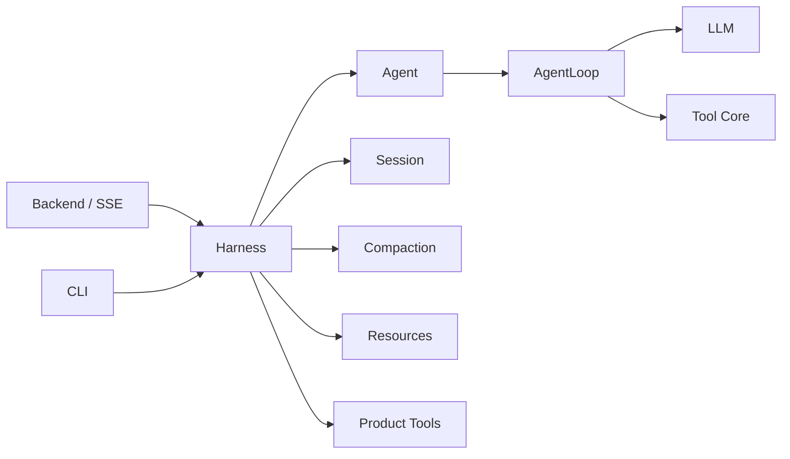
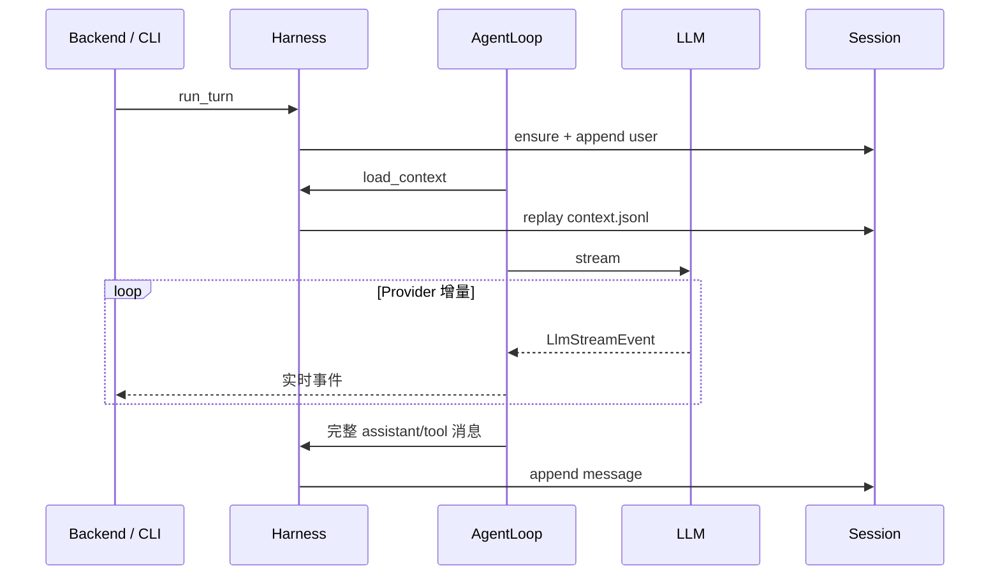

# Camel Harness 项目架构

## 1. 架构目标

Camel Harness 采用受 pi-agent 启发的运行边界架构，不使用 DDD 限界上下文，也不建立 application、domain、infra、ports 等对称分层。代码按复用范围和运行职责分为 Agent、Harness、Backend 与 CLI。

设计目标：

1. Agent Runtime 可脱离持久化和界面独立使用；
2. Session、压缩、资源和产品工具由 Harness 统一编排；
3. HTTP 与 CLI 是可替换的薄入口，互不依赖；
4. 依赖方向明确且可由自动化检查；
5. 只有真实多实现或插件扩展点才保留 ABC。

## 2. 总体边界



允许的主依赖方向：

```text
camel_harness.backend ─┐
                       ├─> camel_harness.harness ─> Agent Core（包根）
camel_harness.cli ─────┘
```

- Agent Core（包根的 Agent、Loop、LLM、Types、Tools）不依赖 Harness、Backend 或 CLI；
- `camel_harness.harness` 可以依赖 Agent，但不依赖 Backend 或 CLI；
- Backend 与 CLI 可以依赖 Harness 和 Agent，彼此不依赖；
- `camel_harness.harness.runtime` 是唯一完整对象图组合模块。

## 3. 目录结构

```text
src/camel_harness/
├── __init__.py               # Agent Core 公共导出
├── agent.py                  # 默认选项与 Agent 门面
├── agent_loop.py             # 流式多 Step ReAct 循环
├── events.py                 # Agent 规范流事件
├── options.py                # 运行选项
├── run.py                    # Turn 状态与预算
├── subagent.py               # 子 Agent 数据契约
├── llm/                      # 统一 LLM 协议与厂商适配
├── tools/                    # 注册、执行、权限和审批协议
├── types/                    # Message、Tool ABC 与稳定值对象
├── harness/
│   ├── agent_harness.py      # 产品级门面
│   ├── runtime.py            # 唯一完整组合模块
│   ├── session/              # JSONL 会话与元数据
│   ├── compaction/           # 上下文组装与压缩
│   ├── resources/            # Skill、Memory 与项目规则
│   └── tools/                # 文件、Shell、MCP、插件和子 Agent
├── backend/
│   ├── api/                  # FastAPI 路由、契约与 SSE
│   ├── approval.py           # 浏览器异步审批
│   └── main.py               # Web 启动入口
└── cli/
    ├── approval.py           # 命令行审批
    ├── terminal.py           # 终端交互与渲染
    └── main.py               # Typer 启动入口
```

功能包内部不机械创建 `models/services/ports`，也不保留旧导入路径的转发模块。

## 4. Agent Runtime

### 4.1 AgentLoop

`AgentLoop` 是最低层的 ReAct 驱动器，只负责：

- 创建 Turn 与 Step 状态；
- 构造 `LlmRequest`；
- 实时转发规范流事件；
- 在流正常结束后组装完整 assistant 消息；
- 执行工具并生成 tool 消息；
- 执行 Step、token、时间和重复调用预算。

它通过上下文加载和完整消息提交回调与外部状态协作，因此不访问 Session、文件系统、HTTP 或资源系统。

### 4.2 Agent

`Agent` 保存默认 `AgentOptions`，为一次运行创建选项快照并委托给 `AgentLoop`。它不承担产品级持久化和资源加载。

### 4.3 LLM

`camel_harness.llm` 包含 `LlmAdapter`、`LlmClient`、规范请求和规范流事件。Anthropic 是默认 Provider，Anthropic 与 OpenAI 适配器均使用官方 Python SDK。

厂商 SDK 对象不得离开该包，对外统一为 `LlmStreamEvent`：

```text
StreamStarted / TextDelta / ReasoningDelta
ToolCallStarted / ToolCallArgumentsDelta / ToolCallCompleted
UsageUpdated / MessageCompleted / StreamFailed / StreamCancelled
```

### 4.4 工具核心

`Tool` ABC、`ToolCall`、`ToolContext` 和 `ToolResult` 位于 `camel_harness.types.tool`。`ToolRegistry` 负责发现和冲突检查，`ToolExecutor` 负责参数校验、授权、审批、超时与结果归一化。

新工具通过 `ToolProvider` 注册，不修改 Agent Loop。具体产品工具位于 `camel_harness.harness.tools`；工具定义直接声明字段并实现 `execute()`。

## 5. Harness

`Harness` 是 Backend 和 CLI 共享的产品级入口，负责：

1. 创建或恢复 Session 并保存 user 消息；
2. 加载项目规则、Skill 和 Memory；
3. 提供压缩感知的上下文加载回调；
4. 只在消息完整形成后提交 assistant/tool 消息；
5. 提供 Session、Workspace 与 Approval 操作；
6. 管理 MCP 生命周期。

一次 Turn 的关键路径：



LLM chunk 从不写入会话。Provider 流异常终止或缺少 `MessageCompleted` 时，不提交不完整 assistant 消息。

## 6. Session 与压缩

所有会话默认存储在：

```text
~/.camel/sessions/<session-id>/
├── metadata.json
├── messages.jsonl
└── context.jsonl
```

- `messages.jsonl` 只追加完整规范消息；
- `context.jsonl` 保存 Append/Replace 投影，不重复复制普通消息；
- `metadata.json` 保存 ID、名称、工作目录、创建/更新时间、消息数和归档状态；
- `JsonlSessionStorage` 是直接实现，不为目前不存在的第二存储建立 ABC；
- 项目不探测或兼容旧会话格式。

`CompactionEngine` 与 `ContextManager` 位于 `camel_harness.harness.compaction`。压缩产生 Replace 投影，原始完整消息仍保留在 `messages.jsonl`。

## 7. Backend 与 CLI

Backend 只处理 Pydantic 请求校验、HTTP 状态码、CORS、SSE 投影和浏览器审批；CLI 只处理参数解析、终端渲染和命令行审批。两者都从 `camel_harness.harness.runtime.build_harness` 获得完整 Harness。

WebUI 的依赖方向保持：

```text
app -> features -> shared
```

浏览器只消费公开 HTTP/SSE 数据，不接触 Provider SDK 或存储对象。

## 8. 抽象策略

保留的主要扩展协议：

- `LlmAdapter`：Anthropic、OpenAI 和测试实现；
- `Tool`：所有内置及外部工具；
- `ToolProvider`：内置、Entry Point、MCP 与延迟搜索来源；
- 审批处理协议：Web、CLI 和测试实现。

单实现流程使用具体类或 callable。权限默认决策、JSONL Session、文件 Memory、文件 Skill、大结果归一化和本地子 Agent 不建立额外 ABC。

## 9. 架构守卫

自动化检查保护以下不变量：

1. Agent Core 位于包根，Harness、Backend 和 CLI 使用明确子包；
2. 不恢复 DDD 目录和机械式 `models/services/ports`；
3. `camel_harness` 不依赖应用层包；
4. `camel_harness.harness` 不依赖入口层包；
5. `camel_harness.types` 只依赖标准库；
6. Import Linter 固化同样的单向依赖；
7. Provider、会话恢复、批量保存、权限审批和工具循环由行为测试保护。
