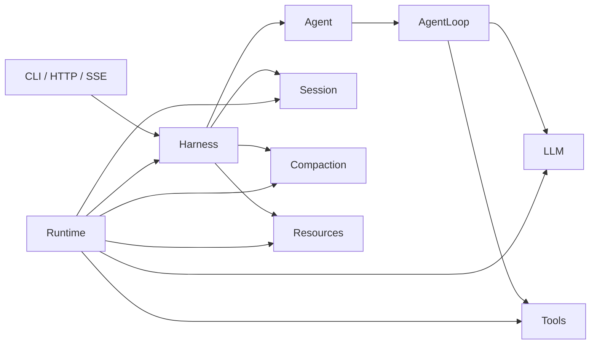
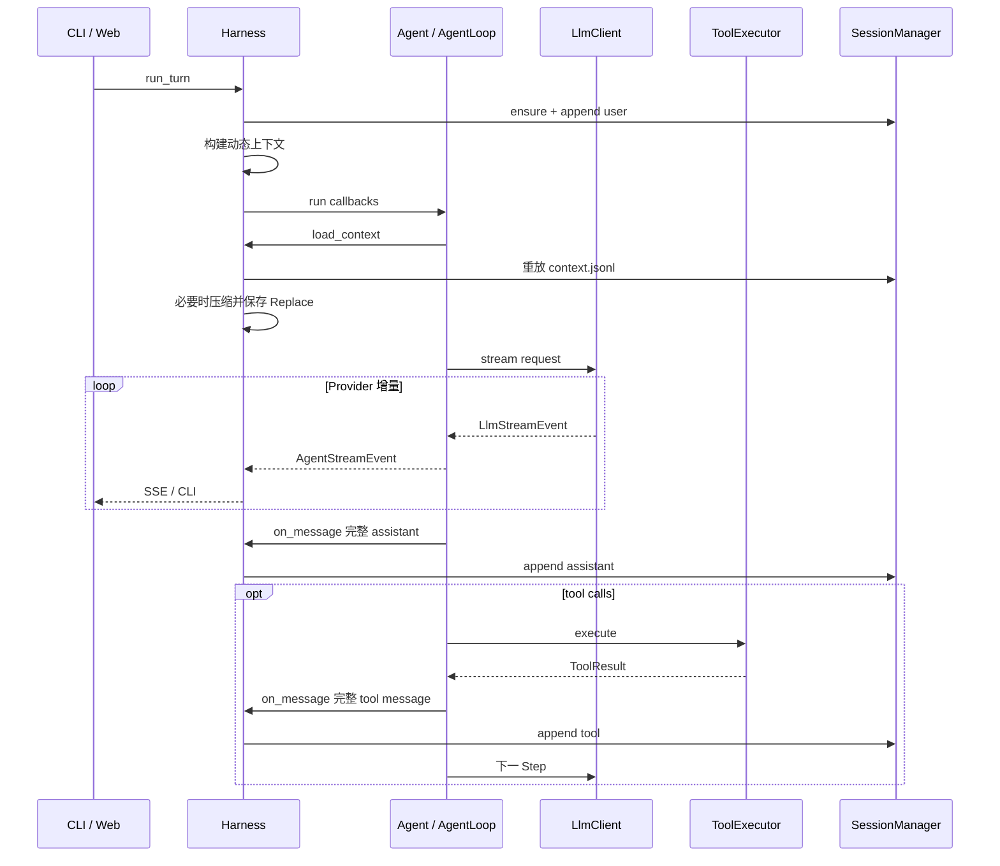

# Camel Harness 项目架构

## 1. 架构方向

Camel Harness 采用受 pi-agent 启发的功能模块架构。项目不再使用 DDD 限界上下文，也不再区分 application、domain、infra 和 adapter。代码按照运行时职责就近组织，并只在真实变化点保留接口。

目标：

1. 从入口到 Agent Loop 的调用链保持短且可追踪；
2. 低层循环可以脱离文件系统和 HTTP 独立测试；
3. Provider、工具和存储仍可替换；
4. 会话、压缩、资源等产品能力由一个 Harness 协调；
5. 不通过目录对称和纯转发对象制造抽象。

## 2. 总体结构



核心依赖：

```text
API / CLI -> Harness -> Agent -> AgentLoop
                  |         |-> LLM
                  |         +-> Tools
                  +-> Session / Compaction / Resources

Runtime -> 所有需要装配的模块
```

`runtime.py` 是唯一完整组合模块。其他功能模块不得依赖 HTTP API，也不得反向依赖 Runtime。

## 3. 目录

```text
backend/
├── agent/
│   ├── agent.py
│   ├── agent_loop.py
│   ├── options.py
│   ├── run.py
│   ├── events.py
│   ├── subagent.py
│   └── local_subagent.py
├── compaction/
│   ├── context.py
│   ├── engine.py
│   └── result.py
├── llm/
│   ├── base.py
│   ├── client.py
│   ├── request.py
│   ├── stream_event.py
│   ├── anthropic.py
│   └── openai.py
├── session/
│   ├── manager.py
│   ├── storage.py
│   ├── jsonl.py
│   ├── metadata.py
│   └── log.py
├── tools/
│   ├── registry.py
│   ├── executor.py
│   ├── permission.py
│   ├── filesystem.py
│   ├── shell.py
│   ├── plugins.py
│   ├── mcp.py
│   └── ...
├── resources/
│   ├── skills.py
│   ├── memory.py
│   ├── project_rules.py
│   └── 文件存储实现
├── types/
│   ├── message.py
│   ├── tool.py
│   ├── identifiers.py
│   └── serialization.py
├── api/
│   ├── routes/
│   ├── contracts.py
│   ├── dependencies.py
│   └── sse.py
├── harness.py
├── runtime.py
├── config.py
├── cli.py
└── web.py
```

功能模块内部不建立 `models/services/ports` 三段式目录。接口与实现放在同一功能包中，通过具体文件名表达职责。

## 4. 三个运行核心

### 4.1 AgentLoop

`AgentLoop` 是最低层的 ReAct 驱动器，负责：

- 创建 Turn/Step 状态；
- 构造 `LlmRequest`；
- 实时转发规范流事件；
- 在流结束后组装完整 assistant 消息；
- 执行工具并产生 tool 消息；
- enforcing Step、token 和时间预算；
- 产生明确终态。

它通过两个回调与外部状态协作：

```python
ContextLoader = Callable[[AgentRun, AgentOptions], Awaitable[tuple[Message, ...]]]
MessageSink = Callable[[Message], Awaitable[None]]
```

因此 Agent Loop 不导入 Session、Compaction、Resources、Harness 或 API。

### 4.2 Agent

`Agent` 保存默认 `AgentOptions`，并把运行请求委托给 `AgentLoop`。运行中使用选项快照，修改默认配置只影响后续 Turn。

### 4.3 Harness

`Harness` 是面向 CLI 和 Web 的产品级门面，负责：

1. 创建或恢复 Session；
2. 保存 user 消息；
3. 加载项目规则、Skill 和 Memory；
4. 为 Agent Loop 提供压缩感知的上下文加载回调；
5. 在完整 assistant/tool 消息形成后提交到 Session；
6. 提供 Session、Workspace 与 Approval API；
7. 管理 MCP 生命周期。

## 5. 一次 Turn 的执行



LLM chunk 从不写入会话。Provider 流缺少 `MessageCompleted` 或异常终止时，不提交不完整 assistant 消息。

## 6. LLM

`LlmAdapter` 是 OpenAI 与 Anthropic 的共同异步流接口，具体实现和厂商转换都位于 `backend.llm`。`LlmClient` 负责 Provider 一致性校验和首事件前重试。

规范事件包括：

```text
StreamStarted
TextDelta
ReasoningDelta
ToolCallStarted
ToolCallArgumentsDelta
ToolCallCompleted
UsageUpdated
MessageCompleted
StreamFailed
StreamCancelled
```

厂商 SDK 对象不会离开 `backend.llm`。默认 Provider 为 Anthropic，两个 Provider 都使用官方 Python SDK。

## 7. 工具

`Tool` ABC 和工具数据契约位于 `backend.types.tool`。具体工具直接声明字段，不再嵌套一份定义对象：

```python
class ReadFileTool(Tool):
    namespace = ""
    name = "read_file"
    label = "读取文件"
    description = "读取工作区中的文本文件"
    parameters = {...}

    async def execute(self, call: ToolCall, context: ToolContext) -> ToolResult:
        ...
```

`ToolRegistry` 负责注册、冲突检测和延迟工具激活；`ToolExecutor` 依次执行参数校验、权限、审批、超时和大结果归一化。内置、Entry Point 和 MCP 工具都通过 `ToolProvider` 进入同一目录。

## 8. Session

默认目录：

```text
~/.camel/sessions/<session-id>/
├── metadata.json
├── messages.jsonl
└── context.jsonl
```

- `messages.jsonl` 只保存完整规范消息；
- `context.jsonl` 保存 Append/Replace 投影操作；
- Append 只引用消息下标，不复制消息；
- Replace 保存摘要与被遮蔽序号区间；
- `metadata.json` 保存 ID、名称、工作目录、创建/更新时间、消息数和归档状态。

`SessionStorage` 是存储变化点，当前实现为 `JsonlSessionStorage`。项目不探测或兼容旧会话格式。

## 9. API 与 WebUI

FastAPI 路由通过 `HttpDependencies` 原子获取完整 `Harness`。路由负责 Pydantic 校验、HTTP 状态码和 JSON/SSE 投影，不创建第二套应用 DTO 或转发 Service。

WebUI 保持：

```text
app -> features -> shared
```

浏览器只消费公开 HTTP/SSE 数据，不接触 Provider SDK 或存储对象。

## 10. 架构守卫

自动化检查包括：

1. 不允许恢复 DDD 顶层目录和 `models/services/ports` 目录；
2. `Tool` 等公共契约必须位于 `backend.types`；
3. `AgentLoop` 禁止依赖 Session、Compaction、Resources、Harness 和 API；
4. `backend.types` 禁止依赖运行功能；
5. 功能模块禁止依赖 HTTP API；
6. OpenAI/Anthropic 使用同一组 Provider contract tests；
7. 会话恢复、批量保存、权限、审批和工具循环使用行为测试保护。
