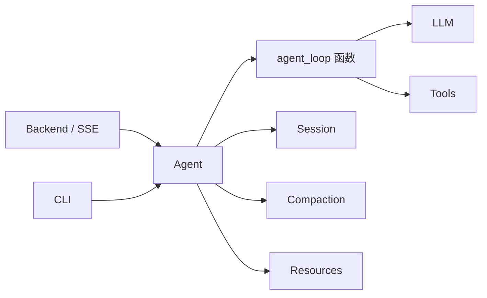
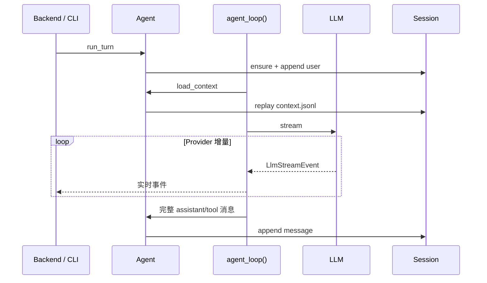

# Camel Harness 项目架构

## 1. 架构目标

Camel Harness 借鉴 pi-agent 的功能分包思想，不使用 DDD 限界上下文，也不建立对称的 application、domain、infra、ports 层。核心代码只分为 `agent` 与 `llm`：前者提供完整 Harness Agent，后者提供可独立复用的模型协议与适配器。

设计目标：

1. 包的数量与真实变化原因一致；
2. Agent 依赖 LLM，LLM 不反向了解 Agent；
3. Backend 与 CLI 是可替换的薄入口，彼此独立；
4. 无状态 Agent Loop 函数与持久化、资源和界面隔离；
5. 只有真实多实现或插件扩展点才保留 ABC。

## 2. 总体边界



允许的主依赖方向：

```text
camel_backend ─┐
                ├─> camel_harness.agent ─> camel_harness.llm
camel_cli ─────┘
```

- `camel_harness.llm` 不依赖 Agent、Backend 或 CLI；
- `camel_harness.agent` 可以依赖 LLM，但不依赖 Backend 或 CLI；
- Backend 与 CLI 可以依赖 Agent，彼此不依赖；
- `camel_harness.agent.runtime` 是唯一完整对象图组合模块。

## 3. 目录结构

```text
src/
├── camel_harness/
│   ├── __init__.py             # 常用 Agent 公共导出
│   ├── llm/
│   │   ├── message.py          # 与 Provider 无关的规范消息
│   │   ├── protocol.py         # 请求、流事件、工具定义与 Adapter 协议
│   │   ├── client.py           # 重试与统一调用入口
│   │   ├── anthropic.py        # Anthropic 官方 SDK 适配
│   │   └── openai.py           # OpenAI 官方 SDK 适配
│   └── agent/
│       ├── agent.py            # 完整产品 Agent
│       ├── agent_loop.py       # 无状态流式多 Step ReAct 函数
│       ├── events.py           # Agent 规范流事件
│       ├── state.py            # 标识、选项、Turn 状态与预算
│       ├── config.py           # 环境配置
│       ├── runtime.py          # 唯一完整组合模块
│       ├── tools/              # 工具契约、执行、安全与具体工具
│       ├── session/            # JSONL 会话、消息编解码与元数据
│       ├── compaction/         # 上下文组装与压缩
│       └── resources/          # Skill、Memory 与项目规则
├── camel_backend/              # FastAPI、SSE 与浏览器审批
└── camel_cli/                  # Typer、终端渲染与命令行审批
```

功能包内部不机械创建 `models/services/ports`，也不保留旧导入路径的转发模块。

## 4. LLM 包

`camel_harness.llm` 是 Agent 的下层依赖，拥有模型交互所需的全部稳定协议：

- `Message = UserMessage | AssistantMessage | ToolResultMessage` 判别联合；
- assistant 专属的文本、思考和工具调用内容块；
- `LlmRequest`、`LlmStreamEvent` 和 `LlmAdapter`；
- 给模型发送的 `ToolDefinition`；
- `LlmClient` 的重试和错误归一化；
- Anthropic 与 OpenAI 官方 Python SDK Adapter。

厂商 SDK 对象不得离开该包，对外统一为规范流事件：

```text
StreamStarted / TextDelta / ReasoningDelta
ToolCallStarted / ToolCallArgumentsDelta / ToolCallCompleted
UsageUpdated / MessageCompleted / StreamFailed / StreamCancelled
```

LLM 包不包含 Session、权限、文件系统或 Agent 状态，因此可以独立演化和测试。

`UserMessage` 只承载用户文本，`AssistantMessage` 只承载 assistant 内容块，`ToolResultMessage` 明确携带调用 ID、工具名、结果和错误状态。这使非法的“角色 + 内容”组合无法用规范类型表达。系统提示不是会话消息，通过 `LlmRequest.system_prompt` 单独传递。

`AssistantMessage.stop_reason` 使用 `LlmStopReason`，只表示单次模型响应为何结束：`stop`、`length` 或 `tool_use`。Provider Adapter 必须将 Anthropic/OpenAI 的厂商字段规范化；Agent 的 `StopReason` 另行表示整个 Turn 的终态，如步数、超时或总 token 预算。

`LlmRequest` 只携带模型、规范消息、系统提示、工具和模型生成参数；`LlmStreamEvent` 只携带事件类型与模型增量数据。两者都不包含 `session_id`、`turn_id`、`step_id`、Agent `sequence` 或运行时 Provider 路由字段。`LlmClient` 已绑定唯一 Adapter，并通过只读 `provider_id` 暴露来源；`AgentOptions` 不再重复保存 Provider。

`ToolDefinition` 只保存模型可见的最终工具名、描述和输入 Schema。namespace 与限定名规则属于 Agent 工具注册表，投影到 LLM 前已经完成。

## 5. Agent 包

### 5.1 agent_loop

`agent_loop()` 借鉴 pi-agent 的低层函数设计，是不持有依赖的异步生成器，只负责：

- 创建 Turn 与 Step 状态；
- 构造 `LlmRequest` 并实时转发流事件；
- 为模型增量添加 Session、Turn、Step、序号和 Provider 来源，提升为 `AgentStreamEvent`；
- 在流正常结束后组装完整 assistant 消息；
- 执行工具并生成 tool 消息；
- 执行 Step、token、时间和重复调用预算。

它通过上下文加载和完整消息提交回调与外部状态协作，不访问 Session、文件系统、HTTP 或资源系统。

### 5.2 Agent

`Agent` 持有运行依赖，是 Backend 和 CLI 共享的唯一执行入口，负责：

1. 创建或恢复 Session 并保存 user 消息；
2. 加载项目规则、Skill 和 Memory；
3. 在需要时压缩上下文；
4. 将完整消息提交给 Session；
5. 通过关闭回调管理自身外部连接生命周期。

其公共方法只保留 `run_turn()` 与幂等 `close()`。Session CRUD、Workspace 选择、Web 审批查询和插件诊断由入口层持有，不通过 Agent 暴露内部组件。

项目不再额外定义 `Harness` 门面；“Harness Agent”就是这个完整 `Agent`。

一次 Turn 的关键路径：



LLM chunk 从不写入会话。Provider 流异常终止或缺少 `MessageCompleted` 时，不提交不完整 assistant 消息。

`agent_loop()` 还会校验结束原因与内容的一致性：`tool_use` 必须存在完整工具调用，`stop` 不得携带工具调用。`length` 会保存已完整接收的 assistant 消息并以 `model_length` 结束 Turn；如果其中存在工具调用，只写入错误 `ToolResultMessage` 闭合协议链，不执行可能被截断的参数。

### 5.3 工具体系

`Tool` ABC、`ToolCall`、`ToolContext` 和 `ToolResult` 位于 `camel_harness.agent.tools.types`；只面向模型的 `ToolDefinition` 位于 LLM 包。工具定义直接声明字段并实现 `execute()`。

新工具通过 `ToolProvider` 注册，不修改 `agent_loop()`。执行统一经过参数校验、权限决策、必要审批、超时和大结果归一化。内置能力包括文件、Shell、搜索、Skill、Memory、MCP、Entry Point 插件和子 Agent。

## 6. Session 与压缩

所有会话默认存储在：

```text
~/.camel/sessions/<session-id>/
├── metadata.json
├── messages.jsonl
└── context.jsonl
```

- `messages.jsonl` 只追加完整规范消息，每行由 `role` 判别三种消息形状；
- `context.jsonl` 保存 Append/Replace 投影，不重复存储流 chunk；
- `metadata.json` 保存 ID、名称、工作目录、创建/更新时间、消息数和归档状态；
- `JsonlSessionStorage` 直接实现本地存储，不为目前不存在的第二存储建立 ABC；
- 项目不探测或兼容旧会话格式。

规范 `Message` 类型属于 LLM 协议，但 `message_to_dict()` 与 `message_from_dict()` 位于 `camel_harness.agent.session.codec`，因为 JSONL 表示属于 Session 持久化边界。

`CompactionEngine` 与 `ContextManager` 位于 `camel_harness.agent.compaction`。压缩产生 Replace 投影，原始完整消息仍保留在 `messages.jsonl`。

## 7. Backend、CLI 与 WebUI

Backend 只处理 Pydantic 请求校验、HTTP 状态码、CORS、SSE 投影和浏览器审批；CLI 只处理参数解析、终端渲染和命令行审批。两者都从 `camel_harness.agent.runtime.build_agent` 获得完整 Agent。

WebUI 的依赖方向保持：

```text
app -> features -> shared
```

浏览器只消费公开 HTTP/SSE 数据，不接触 Provider SDK 或存储对象。

## 8. 抽象策略

保留的主要扩展协议：

- `LlmAdapter`：Anthropic、OpenAI 和测试实现；
- `Tool`：所有内置及外部工具；
- `ToolProvider`：内置、Entry Point、MCP 与延迟搜索来源；
- 审批处理协议：Web、CLI 和测试实现。

单实现流程使用具体类或 callable。JSONL Session、文件 Memory、文件 Skill、大结果归一化和本地子 Agent 不建立额外 ABC。同一变化原因的小型契约优先合并，避免单类文件和转发层泛滥。

## 9. 架构守卫

自动化检查保护以下不变量：

1. `camel_harness` 只保留 `agent` 与 `llm` 两个功能包；
2. 不恢复 DDD 目录和机械式 `models/services/ports`；
3. LLM 不反向依赖 Agent 或入口层；
4. Agent 不依赖 Backend 或 CLI；
5. `agent_loop()` 必须是函数，不得恢复为持有依赖的类，也不访问 Session、压缩、资源或完整组合模块；
6. Backend 与 CLI 彼此独立；
7. Provider、会话恢复、批量保存、权限审批和工具循环由行为测试保护。
8. 架构测试固定 LLM 请求、事件和工具定义的精简字段，防止 Agent 运行坐标再次下沉。
9. 规范消息必须保持三类判别联合，不恢复 `MessageRole` 或可表达非法组合的通用 `Message` 类。
10. `AssistantMessage` 必须保留 LLM 结束原因，并由行为测试保护截断工具调用不被执行。
