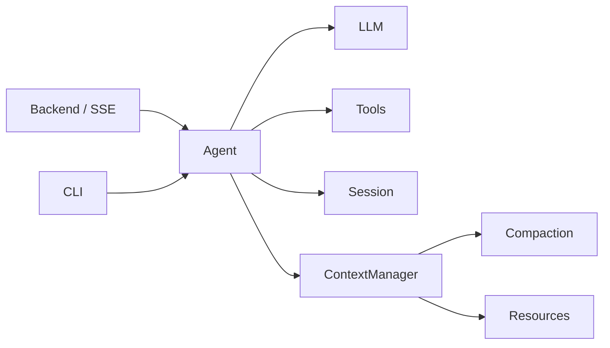
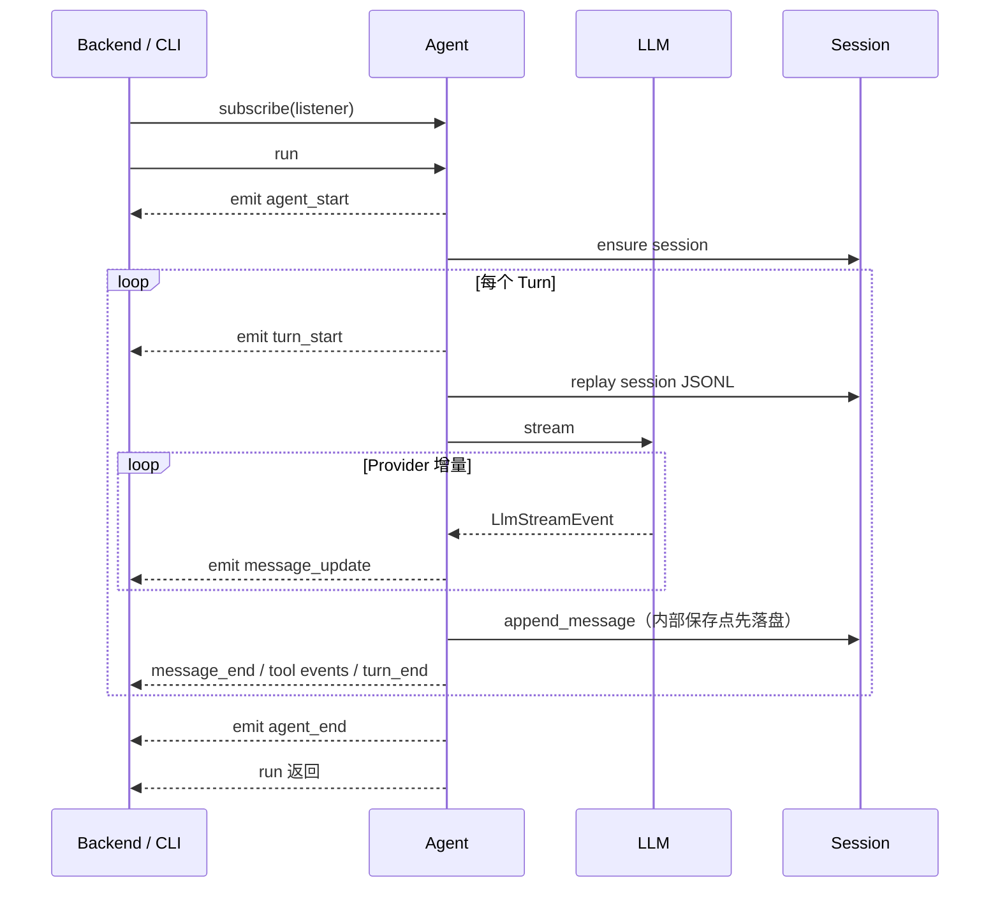

# Camel Harness 项目架构

## 1. 架构目标

Camel Harness 借鉴 pi-agent 的功能分包思想，不使用 DDD 限界上下文，也不建立对称的 application、domain、infra、ports 层。核心代码只分为 `agent` 与 `llm`：前者提供完整 Harness Agent，后者提供可独立复用的模型协议与适配器。

设计目标：

1. 包的数量与真实变化原因一致；
2. Agent 依赖 LLM，LLM 不反向了解 Agent；
3. Backend 与 CLI 是可替换的薄入口，彼此独立；
4. Agent 作为唯一执行对象，内部统一编排 ReAct 循环与产品能力；
5. 只有真实多实现或插件扩展点才保留 ABC。

## 2. 总体边界



允许的主依赖方向：

```text
camel_backend ─┐
                ├─> camel_harness.agent ─> camel_harness.llm
camel_cli ─────┘
```

- `camel_harness.llm` 不依赖 Agent、Backend 或 CLI；
- `camel_harness.agent` 可以依赖 LLM，但不依赖 Backend 或 CLI；
- Backend 与 CLI 可以依赖 Agent，彼此不依赖；
- `camel_harness.agent.runtime` 是唯一完整对象图组合模块。

## 3. 目录结构

```text
src/
├── camel_harness/
│   ├── __init__.py             # 常用 Agent 公共导出
│   ├── llm/
│   │   ├── message.py          # 与 Provider 无关的规范消息
│   │   ├── protocol.py         # 请求、流事件、工具定义与 Adapter 协议
│   │   ├── client.py           # 重试与统一调用入口
│   │   ├── anthropic.py        # Anthropic 官方 SDK 适配
│   │   └── openai.py           # OpenAI 官方 SDK 适配
│   └── agent/
│       ├── agent.py            # 完整 Agent 与流式多 Turn ReAct 循环
│       ├── events.py           # Agent 生命周期事件判别联合
│       ├── state.py            # 选项、Run 状态与用量审计
│       ├── config.py           # 用户级 JSON 配置加载与校验
│       ├── runtime.py          # 唯一完整组合模块
│       ├── tools/              # 工具契约、执行、安全与具体工具
│       ├── session/            # 每会话目录 JSONL、消息编解码与元数据
│       ├── context/            # 上下文组装与历史压缩
│       └── resources/          # 动态系统提示与资源
├── camel_backend/              # FastAPI、SSE、浏览器审批与本机模型配置
│   ├── main.py                 # 组合根：lifespan 装配应用服务
│   ├── orchestration/          # 编排层：HTTP 入口与 Harness 之间的用例编排
│   │   ├── run_service.py      # Agent 注册表与 Run 启动/steer/abort 用例
│   │   ├── session_service.py  # 会话写用例编排（级联删除、模型改绑互斥）
│   │   └── settings_service.py # 模型配置写用例编排（删除占用校验与改绑）
│   ├── web_settings.py         # 本机模型配置仓储与密钥落盘
│   ├── approval.py             # 浏览器审批中心实现
│   ├── workspace.py            # 本机工作区目录选择器
│   └── api/                    # HTTP 层：路由、契约、异常映射、SSE 投影
└── camel_cli/                  # Typer、终端渲染与命令行审批
```

功能包内部不机械创建 `models/services/ports`，也不保留旧导入路径的转发模块。

仓库根目录的 `evals/` 是开发评测，不属于运行时包；`.github/workflows/ci.yml` 将离线任务、Python 质量检查、WebUI 构建和发布包构建串联。`scripts/migrate_flat_sessions.py` 仅供旧平铺日志一次性复制迁移，不进入运行时兼容路径。

## 4. LLM 包

`camel_harness.llm` 是 Agent 的下层依赖，拥有模型交互所需的全部稳定协议：

- `Message = UserMessage | AssistantMessage | ToolResultMessage` 判别联合；
- assistant 专属的文本、思考和工具调用内容块；
- `LlmRequest`、`LlmStreamEvent` 和 `LlmAdapter`；
- 给模型发送的 `ToolDefinition`；
- `LlmClient` 的重试和错误归一化；
- Anthropic 与 OpenAI 官方 Python SDK Adapter。

厂商 SDK 对象不得离开该包，对外统一为规范流事件：

```text
StreamStarted / TextDelta / ReasoningDelta
ToolCallStarted / ToolCallArgumentsDelta / ToolCallCompleted
UsageUpdated / MessageCompleted / StreamFailed / StreamCancelled
```

LLM 包不包含 Session、权限、文件系统或 Agent 状态，因此可以独立演化和测试。

`UserMessage` 只承载用户文本，`AssistantMessage` 只承载 assistant 内容块，`ToolResultMessage` 明确携带调用 ID、工具名、结果和错误状态。这使非法的“角色 + 内容”组合无法用规范类型表达。系统提示不是会话消息，通过 `LlmRequest.system_prompt` 单独传递。

`AssistantMessage.stop_reason` 使用 `LlmStopReason`，只表示单次模型响应为何结束：`stop`、`length` 或 `tool_use`。Provider Adapter 必须将 Anthropic/OpenAI 的厂商字段规范化；Agent 的 `StopReason` 另行表示整个 Run 的终态，如 Turn 数、超时或取消。累计 token 仅作审计，不代表当前上下文窗口大小。

`LlmRequest` 只携带模型、规范消息、系统提示、工具和模型生成参数；`LlmStreamEvent` 是九种不可变 dataclass 的判别联合：`StreamStarted`、`TextDelta`、`ReasoningDelta`、`ToolCallStarted`、`ToolCallArgumentsDelta`、`ToolCallCompleted`、`UsageUpdated`、`MessageCompleted`、`StreamFailed`。事件各自固定 `type`，通过明确字段传递载荷：文本用 `text`，工具调用用 `ToolUseBlock`，累计用量用 `LlmUsage`，结束原因用 `LlmStopReason`。不保留通用 `data` 容器、厂商索引、无生产方的取消事件，也不重复传递 partial 消息快照；取消通过协程传播，最终由 `agent_end` 表达。

请求和事件都不包含 `session_id`、`run_id`、`turn_id`、Agent `sequence` 或运行时 Provider 路由字段。`LlmClient` 已绑定唯一 Adapter，并通过只读 `provider_id` 暴露来源；`AgentOptions` 不再重复保存 Provider。当前 Client 只在首个流事件交付前做固定指数退避重试，尚无按错误类型分类与随机抖动；交付增量后不透明重试。SSE 的 `message_update.assistant_event` 使用相同判别联合，例如 `{"type":"text_delta","text":"你好"}`；只有规范 `message_end` 进入 Session，流事件不落盘。

`ToolDefinition` 只保存模型可见的最终工具名、描述和输入 Schema。namespace 与限定名规则属于 Agent 工具注册表，投影到 LLM 前已经完成。

## 5. Agent 包

### 5.1 Agent

`Agent` 持有运行依赖，是 Backend 和 CLI 共享的唯一执行入口，负责：

1. 创建或恢复 Session，通过完整消息事件提交 user 消息；
2. 加载项目规则、Skill 和 Memory；
3. 持有 Run 执行任务，调用 LLM 并实时投影 `AgentEvent`；
4. 在需要时压缩上下文；
5. 执行工具、审批和运行预算；
6. 仅在流完整结束后生成 `message_end`，Agent 内部保存点先向绑定 Session 追加规范消息，再通知外部订阅者；
7. 通过关闭回调管理自身外部连接生命周期。

一个 `Agent` 实例在构造时接收绑定唯一会话的 `Session` 和 Workspace，只保存一个活动 Run，不持有 `SessionManager`。SessionManager 由入口/组合层共享，负责会话 CRUD、元数据和父子关系；创建或确保会话存在后通过 `bind(session_id)` 获取 Session。Session 的历史读取、消息追加和压缩提交不接收会话 ID，也不创建会话；删除后写入报错，不自动重建。Backend 在入口依赖容器中按 `session_id` 惰性创建并定位 Agent，CLI 只持有当前会话的 Agent。

`AgentRun` 保存 Run 的生命周期、预算与事件序号；`RunControl` 保存 Agent 自己持有的执行任务、steering FIFO、取消标记和完成通知。后者只在运行期间存在且不写入 Session，避免把 asyncio 控制对象混入可恢复的运行状态。入口层不会通过拉取 async generator 驱动 Agent，网络或终端消费者也不拥有 Run。

运行控制方法为：

- `run()`：保存新用户消息、执行 Run，并在终态事件交付完成后返回；
- `steer()`：把运行中输入加入单一 FIFO；
- `abort()`：中断当前 LLM、审批或工具协程；
- `resume()`：从 JSONL 最后一个完整可继续边界创建新 Run；
- `wait_for_idle()`：等待终态事件与清理完成；
- `subscribe()`：顺序订阅 Agent 生命周期事件，并返回取消订阅函数；
- `close()`：中断当前 Run 并关闭外部连接。

Session CRUD、Workspace 选择、Web 审批查询和插件诊断仍由入口层持有，不通过 Agent 暴露内部组件。项目不实现 Follow-up：Run 正常结束后的输入就是下一次普通 `run()`。

`Agent` 仅保留会改变 ReAct 控制流的私有方法。`events.py` 使用判别联合明确表达 Agent、Turn、Message、Tool 与 Approval 生命周期，不再使用可表达非法载荷的通用 `type + data` 事件。

项目不再额外定义 `Harness` 门面；“Harness Agent”就是这个完整 `Agent`。

一次 Run 的关键路径：



LLM chunk 从不写入会话。Provider 流异常终止或缺少 `MessageCompleted` 时，不提交不完整 assistant 消息。

Backend 使用容量受限的内存队列把 `subscribe()` 事件桥接为 SSE；只有这一传输适配层使用 `yield`。CLI 和子 Agent 直接订阅事件。SSE 断开会由 Backend 显式调用 `abort()`，而不是依赖生成器取消偶然终止 Run。SSE 帧虽带 Run 内 `sequence`，当前没有事件回放、断线续传、全局 RunManager 或可脱离 Agent 生命周期的后台任务。

Steering 只在 assistant、工具结果持久化且 `turn_end` 已发送后的安全点消费，每次取最早的一条。Abort 使用 asyncio 任务取消向下传播，未完成 assistant 不落盘；已经保存的工具调用如果缺少结果，会追加错误 `ToolResultMessage` 闭合消息链。Resume 只从 user/tool-result 尾部继续，并使用新的 `run_id`，不会恢复原 token 流或自动重试历史副作用工具。压缩引擎在 Turn 前按上下文压力评估历史；虽然定义了溢出触发类型，Agent 尚未在 Provider 上下文溢出后自动压缩并重试。

`Agent` 还会校验结束原因与内容的一致性：`tool_use` 必须存在完整工具调用，`stop` 不得携带工具调用。`length` 会保存已完整接收的 assistant 消息并以 `model_length` 结束 Run；如果其中存在工具调用，只写入错误 `ToolResultMessage` 闭合协议链，不执行可能被截断的参数。

### 5.2 AgentEvent 生命周期

`AgentEvent` 包含 `agent_start/end`、`turn_start/end`、`message_start/update/end`、`tool_execution_start/end` 和 Camel 扩展的 `approval_requested`。一次 `run()` 拥有唯一 `run_id`，每次模型响应及其工具结果拥有独立 `turn_id`，`sequence` 在整个 Run 内单调递增。

具体事件通过内部 `AgentEventBase`、`TurnEventBase` 和 `MessageEventBase` 复用运行坐标；公开 `AgentEvent` 仍是具体事件的判别联合，SSE 字段形状不变。不同事件只声明自身特有的载荷。

Provider 产生的文本、思考、usage 和工具调用增量不再直接成为顶层 Agent 事件，而是封装在 `MessageUpdateEvent.assistant_event` 中。`agent_end` 是 completed/failed/cancelled 的唯一终态事件，只返回状态、结束原因、token 用量和可选错误，不在 SSE 中重复发送完整会话历史。除协程取消外，可恢复失败以 `agent_end(status=failed)` 干净结束事件流。

### 5.3 工具体系

`Tool` ABC、`ToolCall`、`ToolContext` 和 `ToolResult` 位于 `camel_harness.agent.tools.types`；只面向模型的 `ToolDefinition` 位于 LLM 包。工具定义直接声明字段并实现 `execute()`。

新工具通过 `ToolProvider` 显式注册，不修改 Agent 主流程。执行统一经过参数校验、权限决策、必要审批、超时和大结果归一化。参照 pi-agent，核心集合只保留 `read_file`、`write_file`、`edit_file` 和 `run_shell`；文件列表与文本搜索由 Shell 工具承担，项目外部能力由 MCP 按配置接入。

Skill 和 Memory 都是系统上下文资源。Skill 来源包括随包发布的内置目录、项目级工作区 `.camel/skills` 和用户级 `~/.camel/skills`，同名定义按内置 > 项目级 > 用户级选择。内置 Skill 覆盖代码库探索、故障定位、代码审查和变更验证。`ContextManager` 只将 Skill 名称、描述和来源组成发现索引，并检索相关 Memory；Skill 正文不在发现阶段读取。模型需要 Skill 时使用唯一只读工具 `load_skill` 读取 `SKILL.md` 正文，再根据正文中的相对链接按需读取支持文件。Skill 不提供写入、评估、演化或回滚链路；工具搜索和 Python Entry Point 自动发现也不属于核心 Harness。

`delegate_task` 是唯一额外的编排工具。它为每次委派创建独立 Session，并在子会话元数据中记录父会话 ID 和触发委派的工具调用 ID，不复制父会话消息；Explore/Plan 子 Agent 只获得 `read_file` 和 `load_skill`，General 子 Agent 可使用四个核心工具及 `load_skill`，所有子 Agent 都不获得 `delegate_task`，避免无界递归。

## 6. Session 与压缩

所有会话默认存储在：

```text
~/.camel/sessions/<session-id>/session.jsonl
~/.camel/sessions/<session-id>/subagents/<child-id>/session.jsonl
```

- 首行 `session` 保存 ID、名称、工作目录、创建时间和父子会话关联；
- `message` 保存完整规范消息，`compaction` 保存压缩摘要与替换区间，`session_info` 保存名称、工作目录、模型与归档状态的更新；不保存流 chunk；
- 消息数、最后消息类型和活动时间从同一文件投影，不再维护独立的可变元数据文件；
- Session 删除按后代到父会话的顺序级联；WebUI 顶层会话列表和工作区列表不展示子会话，子会话仍可通过 ID 查询；
- 工具大结果放在所属会话目录的 `tool-results/` 下，主 Agent 和子 Agent 使用相同归一化流程；Session 提供真实目录定位，支持自定义存储根目录和递归子会话，不再向工作区写入结果。模型及消息元数据使用绝对路径引用，文件采用私有权限和唯一名称，删除会话时清理该目录内的结果文件；工作区文件工具仍不允许越界读取这些引用。
- 孙会话继续嵌套在直接父会话的 `subagents/` 下；文件夹层级表达 Agent 会话归属，单份 JSONL 内的 `id/parentId` 则表达同一会话的历史分支，两者互不替代；
- 新布局通过会话 ID 查找独立目录，列表递归发现有效日志并校验头部父 ID 与目录层级；旧的根目录平铺 JSONL 不参与运行时读取，升级时需一次性迁移并保留原文件备份；
- `JsonlSessionStorage` 直接实现本地存储，不为目前不存在的第二存储建立 ABC；不在运行时兼容旧格式；
- 新建会话目录与 JSONL 使用私有权限；读取使用共享文件锁，逐行解析并以 ID 集合校验父引用与重复条目，列表跳过单份损坏日志，单会话读取仍明确报错；树校验需保存 ID 索引，不再声称常量内存；
- 元数据更新在同一文件独占锁内读取旧值并追加新记录，避免并发更新覆盖无关字段；

规范 `Message` 类型属于 LLM 协议，但 `message_to_dict()` 与 `message_from_dict()` 位于 `camel_harness.agent.session.codec`，因为 JSONL 表示属于 Session 持久化边界。

完整 `AssistantMessage` 增加响应审计：`provider` 为适配器协议标识，`model` 为请求模型；SDK 返回不同模型时用 `response_model` 记录实际模型。`usage` 使用厂商无关 `LlmUsage`，记录 `input_tokens`、`output_tokens`、`cache_read_tokens`、`cache_write_tokens` 和 `reasoning_tokens`，总量派生为输入加输出。规范输入包含缓存 Token，输出包含推理 Token，明细不重复累计；Anthropic 原生输入不含缓存，适配器将缓存读取/创建计入规范输入，OpenAI 保留其总输入并映射缓存/推理明细。usage 事件按累计快照合并而非逐事件相加；未报告的明细为 null，没有报告任何用量时消息省略 usage。请求模型始终记录，不从会话当前所选模型倒推历史回答。缓存字段参照 [OpenAI 官方文档](https://developers.openai.com/api/docs/guides/prompt-caching)。

完整 `ToolResultMessage.details` 保留工具附加信息，包括子会话 ID；大工具结果的 `details.content_ref` 是结构化对象，包含 `path`、`mime_type`、`size_bytes`、`original_chars`、`preview_chars`。原文仍放在所属会话的 `tool-results/`，预览及路径提示继续作为模型可见文字，UI/日志不靠解析提示文字识别文件引用。不新增文件下载或越界读取接口。JSONL、HTTP 历史接口与 SSE 完整消息使用同一编解码；WebUI 同时保留实时和历史消息的审计信息，显示回答模型/输入输出用量与工具结果文件信息。未知数据不回填，已有记录没有的审计信息仍为未知。

Provider 请求只投影对话内容，不发送模型/usage/details 等审计字段；压缩预算估算和摘要输入也排除这些元数据。不增加费用估算或独立统计文件；压缩调用的 Token 计入 Run 累计用量审计，并可保存为压缩条目的 usage，不将其冒充某条 Assistant 回答的 usage。

Session 包负责从追加日志构建原始消息、元数据与模型上下文。绑定单个会话的 `Session` 与管理会话生命周期的 `SessionManager` 是具体类，复用同一 JSONL 存储，不新增 ABC 或第二份历史。Session 只接收规范 Message，不导入 AgentEvent：Agent 在 `message_end` 内部保存点先调用 Session 的 `append_message()`，保存成功后再交付外部 UI/CLI 订阅者；保存失败不通知该消息完成，`message_update` 不持久化。子 Agent 委派器属于组合入口，持有 SessionManager 创建子会话，再将绑定 Session 传给子 Agent。

持久化事件在 `session/events.py` 定义为 `SessionEvent` 判别联合：`SessionHeaderEvent`、`SessionMessageEvent`、`SessionCompactionEvent`、`SessionInfoEvent`。会话头之外的三个类型共享条目 `id/parent_id`，通过 codec 映射为 `id/parentId/timestamp`；父节点为 null 表示根，父节点必须已经存在且 ID 唯一，因此不允许环或未来引用。文件只追加，分叉通过新条目引用旧父节点表达，不复制或改写历史。按用户要求，树格式版本重新从 1 开始，不表示兼容历史 version=1 格式，运行时仍拒绝旧 version=2 区间日志；本次不自动迁移、覆盖或删除用户会话，原有平铺迁移脚本仅负责目录复制。

`Session.context_snapshot()` 返回冻结的 `ContextSnapshot(leaf_id, revision, nodes)`：节点为 `ContextNode(entry_id, message)`，不再依赖隐式 seq；revision 是整份日志最后一个消息或压缩条目 ID，用于拒绝并发修改后的旧计划。沿叶节点的 parentId 回溯得到当前路径，再应用路径上的压缩，模型只看到摘要、保留消息与后续消息，不混入兄弟分支。快照没有写入、恢复或存储能力，消息字典仍遵守规范消息的既有只读使用约定。

`CompactionEngine` 与 `ContextManager` 只读取快照节点并生成压缩计划。参考 pi 的独立预算：达到 `context_window_tokens - reserve_tokens` 后评估压缩，从尾部累计 `keep_recent_tokens` 选取切点，并保持工具调用与结果边界；短历史强制压缩时保留最后完整区间，无安全切点则报错。首次摘要与更新已有摘要使用不同提示，历史是待总结数据而非可执行指令。压缩条目采用字符串 `summary`、`firstKeptEntryId`、`tokensBefore` 和可用 usage；边界指向首个保留节点，摘要节点引用压缩条目。估算按 UTF-8 字节约三个字节一个 token，不声称精确计数；触发与结果大小检查包含动态系统提示和工具定义。

压缩配置是全局 JSON 的独立 `compaction` 对象，首次输出上限默认 8192、截断重试上限默认 16384，不受普通回答 `max_output_tokens` 限制。摘要请求关闭思考并约束篇幅；首次 `length` 重新总结同一快照一次，两次均截断则失败，不接受 pi 的宽松截断摘要行为。空摘要、工具结束原因、缺少完整流结束、摘要输入超出窗口或取消都不提交；摘要加保留历史仍超过安全阈值也不提交。每次尝试在 finally 汇报累计用量，Agent 计入 Run 累计用量审计，成功条目保存跨尝试合计 usage，未知字段仍为未知。当前失败采用保守终止 Run 策略，不自动回退到可能超限的旧上下文，也不在同一 Run 无限重试；通过既有 agent_end 报告可恢复错误。Provider 首事件前重试机制未改变，上下文超限自动恢复仍是后续计划。

Agent 将摘要、保留边界及生成计划时的快照交给 `Session.compact()`；存储在独占文件锁内选择当前父节点、校验 revision 与可见节点，校验保留边界存在且前面有待压缩消息，再追加并返回新快照。新增消息、其他压缩或切换到不同上下文分支使旧计划失效，仅元数据更新不影响模型内容。Agent 不再额外修改本地日志。原始消息保留，重启后通过同一重放函数恢复压缩上下文。

`Session.entries()` 提供整棵历史树的条目，`messages()` 提供当前分支未经压缩的原始消息，HTTP 历史与恢复判断仍调用 messages，审计所有兄弟分支则读取 entries。SessionMetadata 的名称、工作目录、归档状态、总消息数从整份日志投影，不随分支回退；暂不引入分支独立工作区和模型配置。

`Session.branch(entry_id)` 选择当前绑定的内存叶游标，`branch(None)` 从空根开始；之后追加的条目连接到该游标，再推进游标。与 pi 一样，仅选择节点不持久化游标，重启默认恢复最后追加条目；继续追加后新分支自然可恢复。Session 不持有 Agent，入口必须在 Agent 空闲时选择分支；目前只有 Session API 和存储能力，没有 WebUI/HTTP 分支导航、跨会话复制、分支摘要或分支删除功能。

ProjectRules、Skills 和 Memory 不是会话历史。`ContextManager.build_system_context()` 将项目规则、Skill 元数据索引和相关 Memory 投影为动态系统提示，但不写入 Session。Skill 正文作为 `load_skill` 的工具结果进入规范消息历史，支持文件只有被显式请求才读取；`ContextManager` 不持有 `SessionManager`、不执行 CRUD、不读写 JSONL，Agent 是两者的唯一协调者。

## 7. Backend、CLI 与 WebUI

Backend 的 HTTP 层只处理 Pydantic 请求校验、HTTP 状态码、CORS、SSE 投影和浏览器审批；CLI 只处理参数解析、终端渲染和命令行审批。两者都从 `camel_harness.agent.runtime.build_agent` 获得完整 Agent。

WebUI 未选择会话时不自动激活历史会话；首次发送先创建会话，其默认工作区是运行 Backend 的当前用户主目录（`Path.home()`）。`/api/workspaces/default` 返回同一路径供前端展示；显式选择本地目录或已有会话时仍使用所选工作区。

Composer 目录选择只决定下一段新会话的工作区，不直接更改现有会话绑定的 Workspace。Token 小面板消费 Provider `usage_updated` 与 `agent_end` 事件，仅显示最近模型请求输入/输出量和本次 Run 总量；没有持久化用量数据时不声称有会话级历史统计。

HTTP 层不直接编排业务规则：路由只调用应用服务并把结果投影为契约 DTO（`api/contracts.py`）。领域异常到状态码的映射集中在 `api/errors.py` 一次注册（KeyError→404、ValueError→422、Agent 冲突→409、steering 队列溢出→429、入口不可用→503），路由内不再逐个 try/except。

Backend 的应用服务集中放在与 `api/` 同级的 `orchestration/` 编排层目录中，与 `web_settings.py`、`approval.py` 平级分离，不建立 DDD 分层目录：

- `RunService` 保存 `session_id -> Agent` 的惰性缓存，保证同一 Session 只定位到一个 Agent，并持有 Run 互斥、模型切换和释放策略；公开运行端点为新 Run、Steer、Abort 和 Resume；
- `SessionService` 编排会话写用例：更新模型选择与活动 Run 互斥，删除会话时先释放后代与自身的 Agent 再级联删除；
- `SettingsService` 编排模型配置写用例：删除被占用的模型前校验活动 Run，删除后把受影响会话改绑到新的默认模型。

删除 Session 时如存在活动 Run 返回冲突。WebUI 在运行期间保持输入框可用，并提供停止与继续操作；CLI 使用普通输入作为 steering，并提供 `/cancel` 和 `/resume`。

CLI、Backend 和真实评测在启动时通过 `AgentSettings.load()` 读取全局 `~/.camel/config.json`；配置模型实例不隐式加载文件，也不读取环境变量或 `.env`。加载器在文件缺失时创建默认 JSON，新建目录使用 `0700`、文件使用 `0600`；先完整写入临时文件再独占发布，避免并发启动覆盖或读到半份配置。已有文件不覆盖，格式和字段错误以中文报错且不回显密钥；CLI 显式参数可覆盖模型配置。修改 JSON 后重启入口生效。

WebUI 设置中的 `DefaultModelEditor` 通过 `GET/PUT /api/settings/config` 可视化配置文件默认模型，表单包含 Provider、模型 ID、API Key 和接口地址。`SettingsService` 负责校验、文件版本冲突检查和权限为 `0600` 的原子替换；只修改模型连接字段，保留预算、存储目录与另一厂商配置。GET 只返回模型字段与密钥存在状态，PUT 空密钥保留旧值，显式清除标志删除当前 Provider 密钥。保存只修改磁盘配置，现有 Run 和会话存储组合不热切换，后端重启后生效。

Web 模型配置由 Backend 的 `web_settings.py` 保存到 `~/.camel/web-settings.json`（或自定义 Session 目录的父目录），默认模型与留空密钥的回退来源为 JSON；用户可添加多个 Anthropic/OpenAI 配置、设置默认模型和思考模式。API 仅返回模型名称、Provider、可用状态和密钥存在状态，不返回密钥内容；本地配置文件及原子替换临时文件使用 `0600` 权限。会话元数据保存所选模型配置 ID，Run/Resume 请求也明确携带该 ID。Backend 在新 Run 前比较配置快照：相同配置复用空闲 Agent，配置或 Provider 改变时重建 Agent；活动 Run 不允许切换模型。

WebUI 的依赖方向保持：

```text
app -> features -> shared
```

浏览器只消费公开 HTTP/SSE 数据，不接触 Provider SDK 或存储对象。

审批快照仅在页面初始化时获取一次，并防止开发模式 StrictMode 重复查询；后续审批状态由 Run SSE 同步，不监听窗口焦点或标签页可见性来重复查询，也不定时轮询。

WebUI 按会话维护独立的 SSE 连接、事件投影、运行/审批状态、Token 用量和输入草稿，允许同页多个会话同时执行。切换视图不会取消原 Run，后台完成不改变选中会话；暂停、运行中输入、恢复和审批均定位操作时的会话。Backend 继续按 `session_id` 定位独立 Agent，每个 Agent 仍最多一个活动 Run。页面关闭或刷新会断开 SSE 并取消对应 Run，不增加全局调度器、断线重放或持久化后台任务。共享工作区的会话没有文件隔离。

## 8. 抽象策略

2026-10-09 职责收敛：Agent 的 `_finish_message()` 负责先保存完整消息，再交由仅负责观察者的 `_emit()` 通知；失败订阅者移除，异步通知等待上限为 5 秒。`agent_end` 只在运行收尾生成一次，工具链修复失败不会跳过终态和清理；取消沿直接等待的 LLM/审批/工具协程传播，不再维护审批轮询任务。同步订阅回调必须快速返回，不能依靠异步超时抢占同步阻塞代码。

ContextManager 计算系统提示与工具定义开销，CompactionEngine 直接从规范 Message 投影摘要输入，不导入 Session codec；Session 只处理完整消息和压缩计划的提交。累计请求 token 与上下文窗口分离，移除累计消耗终止预算和三次重复工具调用规则；Turn 数、运行时长、单次输出上限继续约束运行。

LocalSubagentRunner 只回传最后完整 assistant 的文本，以 agent_end 状态判断成功；取消父委派时关闭子 Agent，避免 run 等待的 shield 留下活动任务。工厂只组合已存在 Session 并校验工作区；会话模型改绑、级联删除、删除模型与启动均受 Backend RunService 同一互斥锁保护，查询审批仍属于具体 WebApproval，而非 Harness 审批中心抽象。

删除只包装字符串的 ID 值对象、参数校验器注入、context_messages 转发及 CompactionResult 重复输入/输出计数字段；标识直接使用 UUID 字符串，工具参数校验由 ToolExecutor 内置，压缩计数使用统一 usage。Memory CRUD、两个配置文件与现有分包保留。

保留的主要扩展协议：

- `LlmAdapter`：Anthropic、OpenAI 和测试实现；
- `Tool`：所有内置及外部工具；
- `ToolProvider`：内置与 MCP 两种真实工具来源；
- 审批处理协议：Web、CLI 和测试实现。

单实现流程使用具体类或 callable。JSONL Session、文件 Memory、文件 Skill 和大结果归一化不建立额外 ABC。同一变化原因的小型契约优先合并，避免单类文件和转发层泛滥。

## 9. 架构守卫

自动化检查保护以下不变量：

1. `camel_harness` 只保留 `agent` 与 `llm` 两个功能包；
2. 不恢复 DDD 目录和机械式 `models/services/ports`；
3. LLM 不反向依赖 Agent 或入口层；
4. Agent 不依赖 Backend 或 CLI；
5. ReAct 循环必须保持在 `Agent` 内部，不恢复独立 `agent_loop` 模块或公开函数；
6. Backend 与 CLI 彼此独立；
7. Provider、会话恢复、批量保存、权限审批和工具循环由行为测试保护。
8. 架构测试固定 LLM 请求、事件和工具定义的精简字段，防止 Agent 运行坐标再次下沉。
9. 规范消息必须保持三类判别联合，不恢复 `MessageRole` 或可表达非法组合的通用 `Message` 类。
10. `AssistantMessage` 必须保留 LLM 结束原因，并由行为测试保护截断工具调用不被执行。
11. `ContextManager` 与 `CompactionEngine` 必须位于 `agent/context/`，不得依赖 SessionManager 或 JSONL 存储。
12. `AgentEvent` 必须保持生命周期判别联合，不恢复 `AgentStreamEvent` 通用容器。
13. 一个 Agent 必须只绑定一个 Session/Workspace，并由行为测试保护单活动 Run、steering 安全点、abort 完整消息边界和 resume 规则。
